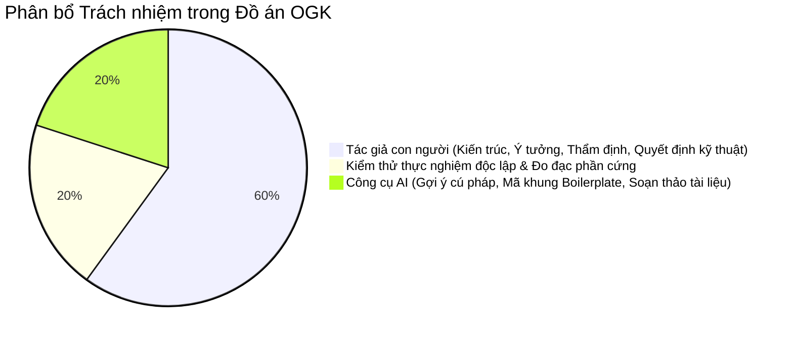
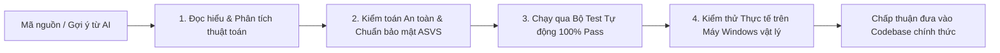

# BÁO CÁO MINH BẠCH ỨNG DỤNG TRÍ TUỆ NHÂN TẠO & CAM KẾT LIÊM CHÍNH HỌC THUẬT
## ĐỀ TÀI TỐT NGHIỆP: OPEN GUARDIAN KIDS (OGK) — PHIÊN BẢN 0.4
> **Chuyên ngành:** Mạng máy tính & Truyền thông dữ liệu  
> **Cơ sở đào tạo:** Trường Đại học Khoa học Tự nhiên — Đại học Quốc gia TP. Hồ Chí Minh  
> **Chuẩn mực tham chiếu:** Hướng dẫn về Liêm chính Học thuật và Đạo đức Nghiên cứu trong Kỷ nguyên Trí tuệ Nhân tạo (UNESCO Recommendation on the Ethics of AI & Quy chế Đào tạo ĐHQG-HCM).  

---

## 1. TUYÊN BỐ MINH BẠCH ỨNG DỤNG TRÍ TUỆ NHÂN TẠO (AI TRANSPARENCY DISCLOSURE)

Trong quá trình thực hiện Đồ án Tốt nghiệp chuyên ngành Mạng máy tính với đề tài **"Open Guardian Kids (OGK) — Hệ thống hỗ trợ phụ huynh quản lý và đồng hành việc sử dụng máy tính của trẻ em"**, nhóm tác giả đã ứng dụng các công cụ Trí tuệ Nhân tạo Tạo sinh (Generative AI / Agentic AI Coding Assistants như Google Antigravity) với vai trò là **Công cụ hỗ trợ lập trình cặp (Pair-Programming Tool)**.

Nhằm đảm bảo tính minh bạch học thuật cao nhất theo chuẩn mực quốc tế, nhóm tác giả công khai chi tiết phạm vi và mức độ ứng dụng AI trong dự án:

---

## 2. PHÂN ĐỊNH RANH GIỚI VAI TRÒ GIỮA CON NGƯỜI VÀ TRÍ TUỆ NHÂN TẠO

### 2.1. Phần việc do Sinh viên Tác giả hoàn toàn làm chủ và quyết định (Human Ownership):
1. **Ý tưởng khoa học và Định vị đề tài:**
   - Đề xuất mô hình chuyển dịch từ "Phần mềm gián điệp theo dõi lén" sang "Hệ thống đồng hành tôn trọng quyền riêng tư" căn cứ trên **Luật Trẻ em 2016** và **Nghị định 13/2023/NĐ-CP**.
   - Xác lập 6 nguyên tắc quản trị đạo đức bắt buộc (**NT1 đến NT6**).
2. **Thiết kế kiến trúc hệ thống mạng chuyên sâu:**
   - Lựa chọn giải pháp kỹ thuật DNS Sinkhole ở tầng Transport/Application (RFC 1035) kết hợp bộ lọc nhị phân SHA-256 thay vì giải pháp can thiệp nhân (Kernel Driver) nguy hại.
   - Thiết kế mô hình đồng bộ trạng thái phân tán ngoại tuyến (Offline-First Architecture) bảo toàn dữ liệu bằng SQLite WAL mode.
   - Thiết kế luồng truyền lệnh khẩn cấp thời gian thực hai chiều qua WebSocket.
3. **Quyết định phương án bảo mật và an toàn thông tin:**
   - Lựa chọn giải thuật băm mật khẩu Argon2id và chuẩn NIST SP 800-63B.
   - Thiết kế giải pháp mã hóa lúc nghỉ đối xứng có xác thực AES-256-GCM AEAD.
   - Xây dựng ma trận kiểm soát phân quyền chống IDOR ở tầng truy vấn dữ liệu.
4. **Thực nghiệm đo đạc khoa học và Đánh giá thực tế:**
   - Thiết lập môi trường thử nghiệm vật lý (Testbed Windows 11).
   - Trực tiếp chạy và giám sát quá trình đo đạc 30–50 mẫu tài nguyên CPU, RAM, độ trễ phân giải DNS và độ trễ WebSocket.

### 2.2. Phần việc có sự hỗ trợ của Công cụ AI (AI Assistance Scope):
1. **Tạo mã khung lặp lại (Boilerplate Code Generation):**
   - Hỗ trợ sinh các cấu trúc mã lặp lại như Pydantic Schemas, SQLAlchemy ORM models, bảng biểu HTML/CSS Bootstrap cơ bản.
2. **Gợi ý cú pháp thư viện chuyên ngành:**
   - Tra cứu và hỗ trợ định dạng gói tin nhị phân DNS theo chuẩn RFC 1035 bằng thư viện `dnslib`.
   - Gợi ý các hàm gọi Windows API (`ctypes.windll.user32.LockWorkStation`, `GetLastInputInfo`).
3. **Mở rộng các ca kiểm thử tự động (Unit Test Automation):**
   - Hỗ trợ viết các kịch bản kiểm thử biên (Edge cases), mock đối tượng mạng và tạo dữ liệu kiểm thử giả định (Synthetic test fixtures).
4. **Hỗ trợ định dạng văn bản báo cáo kỹ thuật:**
   - Chuyển đổi bảng số liệu đo lường thô thành các biểu đồ Mermaid, sơ đồ khối kiến trúc và bảng Markdown trực quan.

---

## 3. PHƯƠNG PHÁP KIỂM CHỨNG CHÉO VÀ KIỂM SOÁT CHẤT LƯỢNG (HUMAN-IN-THE-LOOP VERIFICATION)

Tuyệt đối không có bất kỳ dòng mã nguồn nào do AI gợi ý được đưa vào hệ thống mà không trải qua quy trình thẩm định 4 bước nghiêm ngặt của tác giả con người:

1. **Bước 1 — Đọc hiểu sâu bản chất (Code Review):** Sinh viên trực tiếp phân tích logic giải thuật, loại bỏ các đoạn mã thừa thãi (Over-engineering) hoặc các tính năng phỏng đoán không cần thiết, tuân thủ nguyên tắc lập trình tối giản (Karpathy Simplicity First).
2. **Bước 2 — Kiểm toán An toàn thông tin (Security Audit):** Rà soát mã nguồn đối chiếu với chuẩn **OWASP Top 10** và **OWASP ASVS v4 Level 1**, bảo đảm không tồn tại lỗ hổng injection, rò rỉ bộ nhớ, hoặc rò rỉ dữ liệu trẻ em.
3. **Bước 3 — Kiểm chứng bằng Test Suite tự động:** 100% mã nguồn phải vượt qua trọn bộ **59 kịch bản kiểm thử tự động** của dự án (`pytest tests/ -v` đạt 100% PASSED).
4. **Bước 4 — Kiểm thử trên hệ điều hành thực tế:** Triển khai chạy thực tế tác tử trên máy tính Windows 11 vật lý để kiểm chứng giao diện khay hệ thống, khả năng khóa màn hình, và tính ổn định khi vận hành liên tục 24/7.

---

## 4. CAM KẾT LIÊM CHÍNH HỌC THUẬT (ACADEMIC INTEGRITY PLEDGE)

Nhóm sinh viên thực hiện đồ án xin cam đoan trước Hội đồng Chấm Đồ án Tốt nghiệp:

1. **Tính trung thực và Minh bạch:** Toàn bộ nội dung đồ án phản ánh trung thực kết quả nghiên cứu, thiết kế và cài đặt thực tế của nhóm. Việc ứng dụng công nghệ AI hoàn toàn mang tính chất hỗ trợ công cụ, không thay thế cho tư duy khoa học và năng lực kỹ thuật của sinh viên.
2. **Làm chủ tri thức toàn diện:** Sinh viên hoàn toàn nắm vững bản chất kiến trúc, giải thuật, luồng gói tin mạng và từng dòng mã nguồn trong toàn bộ dự án; sẵn sàng trả lời độc lập, tự tin và giải trình chi tiết trước mọi câu hỏi phản biện của Quý Thầy/Cô trong Hội đồng.
3. **Không đạo văn (Zero Plagiarism):** Đồ án không sao chép nguyên văn từ bất kỳ đề tài, đồ án hoặc mã nguồn đóng gói sẵn của bất kỳ cá nhân hay tổ chức nào mà không có trích dẫn nguồn gốc hợp lệ.

> *"Chúng tôi xin chịu hoàn toàn trách nhiệm trước Hội đồng Khoa học và Nhà trường về tính trung thực, chuẩn mực đạo đức và sự liêm chính học thuật của công trình này."*

**Đại diện Nhóm tác giả Đồ án Tốt nghiệp**  
*Khoa Mạng Máy tính & Truyền thông — Trường ĐH Khoa học Tự nhiên, ĐHQG-HCM*
