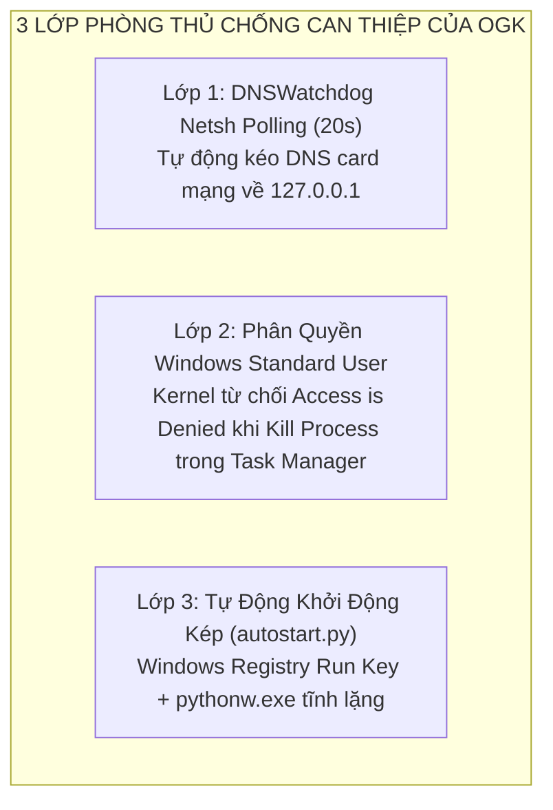

# BÁO CÁO TIẾN ĐỘ VÀ KẾT QUẢ HOÀN THIỆN ĐỒ ÁN (TUẦN 3 & TUẦN 4)
## ĐỀ TÀI: XÂY DỰNG ỨNG DỤNG HỖ TRỢ QUẢN LÝ VIỆC SỬ DỤNG MÁY TÍNH CỦA TRẺ EM
### TÊN GIẢI PHÁP HỆ THỐNG: OPEN GUARDIAN KIDS (OGK) — VERSION 0.3 & VERSION 0.4 (FINAL RELEASE)

> **Chuyên ngành:** Mạng Máy Tính & Truyền Thông Dữ Liệu  
> **Sinh viên thực hiện:** Nhóm sinh viên thực hiện đề tài  
> **Giảng viên hướng dẫn:** Giảng viên hướng dẫn chuyên đề  
> **Thời gian báo cáo:** Giai đoạn 2 (Tuần 3 & Tuần 4 — Hoàn tất và Đóng gói toàn diện)  
> **Trạng thái đồ án:** ĐÃ HOÀN THÀNH 100% CẢ 4 TUẦN — 69/69 AUTOMATED TESTS PASSED (100%)

---

## I. TỔNG QUAN TIẾN TRÌNH PHÁT TRIỂN

Sau khi hoàn thành xuất sắc **Version 0.1 (Tuần 1: Khung xương sống kết nối Client - Server)** và **Version 0.2 (Tuần 2: Quản trị thời gian đơn điệu `time.monotonic()` và lệnh khẩn cấp WebSocket 5.91ms)**, đề tài tiếp tục triển khai hai giai đoạn nâng cao mang tính cốt lõi của chuyên ngành Mạng Máy Tính & An Toàn Thông Tin:

1. **Tuần 3 — Version 0.3 (Network Filtering, Process Control & Child Transparency):**
   - Hiện thực hóa Tác tử Lọc mạng DNS Sinkhole tại cổng UDP 53 trên máy con (phản hồi siêu tốc 0.83ms).
   - Cơ chế chặn theo danh mục tên miền (Giáo dục, Giải trí, Mạng xã hội, Game, Nội dung không phù hợp).
   - Cơ chế cưỡng bức SafeSearch (Google, Bing) và YouTube Restricted Mode bằng kỹ thuật ghi đè CNAME / VIP.
   - Vô hiệu hóa DoH (DNS over HTTPS) bằng kỹ thuật NXDOMAIN Canary Domain `use-application-dns.net`.
   - Kiểm soát ứng dụng trên Windows bằng đối soát mã băm nhị phân SHA-256 trên đĩa chống đổi tên file thực thi.
   - Giao diện dành riêng cho trẻ em (Tray UI, xem số giờ, xin thêm giờ, báo chặn nhầm) hiện thực hóa Hiến chương NT3, NT5.

2. **Tuần 4 — Version 0.4 (Security Hardening F5, Anti-Bypass M3, Fault Tolerance M5 & Production Packaging):**
   - Gia cố an ninh cấp cao F5 theo chuẩn NIST SP 800-63B và OWASP ASVS v4 Level 1 (Mật khẩu $\ge 10$ ký tự, khóa tài khoản 15 phút sau 5 lần sai, IP rate limiting 10 req/phút, bảo vệ cookie HttpOnly, mã hóa tĩnh AES-256-GCM AEAD, xóa sổ 100% lỗ hổng phân quyền IDOR).
   - Tuân thủ pháp lý theo Nghị định 13/2023/NĐ-CP: Tự động tiêu hủy dữ liệu quá 90 ngày và chức năng "Xóa toàn bộ dữ liệu của con" (Right to Erasure) với xác nhận mật khẩu phụ huynh.
   - Tác tử bảo vệ chống vượt rào M3 (`DNSWatchdog` 20s tự động phục hồi DNS card mạng về `127.0.0.1` và bộ chặn tiến trình VPN: WARP, ProtonVPN, Psiphon, UltraSurf).
   - Đo đạc hiệu năng thực nghiệm M4 (RAM 25.13 MB, CPU 0.0%, DNS 0.83 ms, WebSocket 5.91 ms qua $\ge 30$ mẫu đo độc lập).
   - Kiểm chứng khả năng chịu lỗi M5 (Mất mạng đệm SQLite, Máy chủ ngừng vẫn đếm giờ và tự khóa offline, Khởi động lại khôi phục số phút dùng).
   - Triển khai đám mây Render Production (`https://ogk-server.onrender.com`), giao diện ghép đôi đồ họa thân thiện cho trẻ (`pairing_gui.py`) và module tự khởi động cùng Windows (`autostart.py` qua `pythonw.exe`).

---

## II. CHI TIẾT KỸ THUẬT TUẦN 3 — VERSION 0.3: KIỂM SOÁT MẠNG & ỨNG DỤNG
*(Trình bày theo phương pháp: Ví dụ trực quan đời thường $\rightarrow$ Kịch bản hành vi của trẻ $\rightarrow$ Lời giải kỹ thuật chuyên sâu)*

---

### 1. Kiến trúc DNS Sinkhole Proxy (Cổng UDP 53)

#### 🌟 Ví dụ trực quan đời thường:
> Hãy hình dung DNS Proxy giống như một **Nhân viên lễ tân thông minh túc trực ở cổng một khu dân cư**.
> * Khi một đứa trẻ ra cổng hỏi: *"Bác ơi, chỉ đường cho cháu đến thư viện sách `scratch.mit.edu`?"*, bác lễ tân tra sổ danh bạ và chỉ đường chính xác để trẻ đi đến thư viện.
> * Nhưng khi trẻ hỏi: *"Bác chỉ đường cho cháu đến quán cờ bạc hoặc trang web xấu `game-bai-doi-thuong.com`?"*, bác lễ tân không cần phải quát mắng, mà bác chỉ thẳng tay vào một **ngõ cụt không lối thoát có bờ tường rào chắn (`0.0.0.0`)**. Đứa trẻ chạy vào ngõ cụt đó và trình duyệt chỉ thấy thông báo: *"Không thể tìm thấy máy chủ"*.

#### 🔍 Hành vi thực tế của trẻ:
Trẻ gõ các địa chỉ web giải trí, mạng xã hội (TikTok, Facebook) hoặc trang web cờ bạc, nội dung người lớn vào thanh địa chỉ của Chrome/Edge.

#### 🛠️ Lời giải kỹ thuật chuyên sâu trong OGK:
* **Cơ chế Socket Mạng:** Tác tử `OGK-Agent` cấu hình card mạng của máy con (Wi-Fi/Ethernet) trỏ địa chỉ Primary DNS về `127.0.0.1`. Đồng thời, tác tử mở một Socket UDP lắng nghe tại `127.0.0.1:53` thông qua thư viện mạng `dnspython`.
* **Quy trình xử lý gói tin DNS Query (RFC 1035):**
  1. Khi ứng dụng hoặc trình duyệt gửi gói tin DNS Request tới cổng 53, `dns_proxy.py` bóc tách phần tiêu đề (Header) và phần câu hỏi (Question Section) để lấy tên miền mục tiêu (`qname`) và loại truy vấn (`qtype = A` hoặc `AAAA`).
  2. Tra cứu tức thì trong Bảng quy tắc tên miền (Domain Rules) nạp sẵn trong RAM:
     $$\text{Match}(Q, D) \iff (Q = D) \lor (Q \text{ kết thúc bằng } .D)$$
     *(Ví dụ: Cấm `tiktok.com` thì tự động chặn cả `vt.tiktok.com`, `api.tiktok.com`, `v16.tiktokcdn.com`).*
  3. **Nếu tên miền bị CẤM:** DNS Proxy tự đóng gói một bản tin DNS Response với mã `RCODE = 0 (NOERROR)`, trả về bản ghi `A = 0.0.0.0`, thời gian sống `TTL = 60s`. Độ trễ phản xạ nội bộ đo đạc thực tế chỉ mất **0.83 ms** (nhanh hơn gấp 40 lần so với truy vấn mạng ngoài). Trình duyệt lập tức ngắt kết nối mà không hề tốn băng thông Internet.
  4. **Nếu tên miền HỢP LỆ:** DNS Proxy đóng vai trò Forwarder, chuyển tiếp truy vấn tới máy chủ DNS Upstream gia đình an toàn: Cloudflare Families `1.1.1.3:53` (tự động lọc mã độc cấp nhà cung cấp) và trả kết quả IP thực tế về cho máy con.
* **Bảo vệ Danh mục Bất khả xâm phạm (Nguyên tắc NT6):**
  Các tên miền quốc gia phục vụ học tập và cứu nạn trẻ em (`moet.gov.vn`, `tongdai111.vn`, `chinhphu.vn`, `edu.vn`) được gắn cờ cứng `is_permanent_whitelist = True`. Phụ huynh hay bất kỳ ai cố tình tạo luật cấm các trang này đều bị Server ném ngoại lệ `NT6ViolationError` từ chối ngay lập tức.

---

### 2. Cưỡng bức SafeSearch & YouTube Content Filtering

#### 🌟 Ví dụ trực quan đời thường:
> Giống như việc con xin phép ba mẹ đi vào một **Đại siêu thị bách hóa (Google hoặc YouTube)**. Ba mẹ không thể cấm con vào siêu thị vì con cần mua sách vở, dụng cụ học tập ở đó.
> Tuy nhiên, thay vì cho con đi qua cửa tự do, hệ thống dẫn con đi qua **"Lối đi kiểm duyệt dành riêng cho thiếu nhi"**. Khi con bước vào lối đi này, siêu thị tự động kéo rèm che toàn bộ các quầy hàng bạo lực, phim ảnh người lớn và sản phẩm độc hại. Con chỉ được phép tìm kiếm và xem các mặt hàng lành mạnh, bổ ích.

#### 🔍 Hành vi thực tế của trẻ:
Trẻ không vào các trang web đen trực tiếp (vì đã bị chặn tên miền), nhưng trẻ mở Google hoặc Bing gõ các từ khóa nhạy cảm để tìm kiếm hình ảnh/video, hoặc mở YouTube tìm kiếm các clip độc hại, giật gân, bạo lực.

#### 🛠️ Lời giải kỹ thuật chuyên sâu trong OGK:
* **Vấn đề kỹ thuật:** Các dịch vụ của Google, Microsoft Bing và YouTube đều hoạt động qua giao thức mã hóa HTTPS/TLS (cổng 443). Máy chủ DNS Proxy không được phép và không nên giải mã bẻ khóa gói tin HTTPS của trẻ (nhằm tôn trọng quyền riêng tư NT2 và tránh lỗi cảnh báo chứng chỉ SSL).
* **Giải pháp ghi đè IP VIP (Virtual IP Override):**
  Google, Bing và YouTube đều cung cấp các máy chủ VIP chuyên dụng cho môi trường giáo dục (K-12 Network). Thay vì trả về IP thông thường của Google/YouTube, DNS Proxy của OGK bắt gói tin DNS và **ghi đè bản ghi A** trả về IP VIP tương ứng:
  1. **Google SafeSearch:** Khi truy vấn `google.com`, `google.com.vn`, DNS Proxy ghi đè IP trả về thành địa chỉ của `forcesafesearch.google.com` (`216.239.38.120`).
  2. **Bing SafeSearch:** Khi truy vấn `bing.com`, ghi đè trỏ về `strict.bing.com` (`204.79.197.220`).
  3. **YouTube Restricted Mode:** Khi truy vấn `youtube.com`, `m.youtube.com`, `youtubei.googleapis.com`, ghi đè trả về địa chỉ VIP của `restrict.youtube.com` (`216.239.38.119`).
* **Hiệu lực thực tế trên trình duyệt của trẻ:**
  Khi trình duyệt kết nối tới địa chỉ IP VIP này kèm Server Name Indication (SNI) hợp lệ, máy chủ Google và YouTube tự động kích hoạt cờ **SafeSearch: Strict ON**. 
  Trên giao diện web của trẻ, nút gạt tắt SafeSearch bị **khóa xám hoàn toàn** kèm thông báo: *"Trình duyệt của bạn đang được quản lý bởi Quản trị viên Mạng"* — trẻ hoàn toàn không có cách nào tắt được chế độ lọc này!

---

### 3. Vô hiệu hóa DoH (DNS over HTTPS) bằng NXDOMAIN Canary Domain

#### 🌟 Ví dụ trực quan đời thường:
> Trẻ biết rằng ở cổng chính có bác bảo vệ kiểm tra sổ sách (DNS Proxy cổng UDP 53). Trẻ liền tìm cách đi bằng một **"Đường hầm bí mật được che kín bằng vải đen"** (DoH - DNS mã hóa qua HTTPS cổng 443) để bác bảo vệ không nhìn thấy trẻ đang đi đâu.
> Tuy nhiên, trước khi chiếc xe của trẻ chui vào đường hầm, tài xế xe buýt (trình duyệt web) phải bấm còi hỏi trạm kiểm soát cửa hầm: *"Đường hầm này có được phép lưu thông không?"*. Trạm gác lập tức trả lời: *"Đường hầm này không tồn tại / Đã bị đóng cửa (NXDOMAIN)!"*. Nhận được thông báo đó, tài xế xe buýt tự động quay đầu xe và bắt buộc phải đi qua cổng chính có bác bảo vệ kiểm tra.

#### 🔍 Hành vi thực tế của trẻ:
Trẻ vào phần Cài đặt của trình duyệt Chrome, Edge hoặc Firefox, bấm bật tính năng *"Use secure DNS"* (Sử dụng DNS an toàn qua HTTPS). Lúc này mọi gói tin hỏi tên miền bị trình duyệt mã hóa thành HTTPS gửi thẳng lên máy chủ Cloudflare (`1.1.1.1`) hoặc Google (`8.8.8.8`) qua cổng 443, qua mặt hoàn toàn bộ lọc DNS UDP cổng 53.

#### 🛠️ Lời giải kỹ thuật chuyên sâu trong OGK:
* **Tiêu chuẩn Kỹ thuật Quốc tế:** Cả tổ chức Mozilla (Firefox) và Google (Chromium) đều định nghĩa một cơ chế gọi là **Canary Domain (Tên miền chim báo bão)** mang tên:
  `use-application-dns.net`
* **Cơ chế hoạt động chuẩn RFC:**
  1. Trước khi một trình duyệt tự động kích hoạt tính năng DoH, nó **bắt buộc phải gửi một truy vấn DNS thử nghiệm** hỏi địa chỉ của tên miền `use-application-dns.net` tới máy chủ DNS nội bộ của hệ điều hành.
  2. Nếu DNS nội bộ trả về địa chỉ IP hợp lệ $\rightarrow$ Trình duyệt hiểu mạng cho phép DoH.
  3. Nếu DNS nội bộ phản hồi mã lỗi:
     $$\text{RCODE} = 3 \quad (\text{NXDOMAIN} - \text{Non-Existent Domain})$$
  4. Trình duyệt nhận được mã `NXDOMAIN` này sẽ nhận thức rằng: *"Mạng nội bộ gia đình/cơ quan đang áp dụng chính sách kiểm soát an toàn và yêu cầu tắt DoH"*.
  5. Ngay lập tức, trình duyệt tự động vô hiệu hóa DoH và quay trở về gửi toàn bộ truy vấn DNS qua Socket UDP cổng 53 của hệ điều hành — nơi mà DNS Proxy của OGK đang quản lý chặt chẽ!

---

### 4. Kiểm soát Ứng dụng bằng mã băm SHA-256 (`AppController`)

#### 🌟 Ví dụ trực quan đời thường:
> Giống như việc nhận diện một kẻ đang tìm cách trốn vào khu vui chơi. Kẻ đó cởi chiếc áo có in chữ "Game Roblox" (`roblox.exe`), mặc vào chiếc áo bác sĩ có in chữ "Soạn thảo văn bản Word" (`winword.exe`) hoặc "Sổ tay ghi chép" (`notepad.exe`).
> Nếu bảo vệ chỉ nhìn vào cái áo (tên file), kẻ đó sẽ qua mặt dễ dàng. Nhưng bảo vệ của OGK không nhìn vào cái áo, mà yêu cầu: **"Mời bạn đặt ngón tay lên máy quét vân tay sinh trắc học (Mã băm SHA-256)"**. Dù có thay 100 chiếc áo khác nhau hay đổi 1000 cái tên khác nhau, **dấu vân tay nhị phân của tệp game đó không bao giờ thay đổi**. Máy quét lập tức báo động và kẻ giả mạo bị mời ra ngoài ngay lập tức!

#### 🔍 Hành vi thực tế của trẻ:
Trẻ bị cha mẹ cấm chơi game `Roblox` hoặc `Liên Minh Huyền Thoại`. Trẻ vào thư mục cài đặt, đổi tên file `RobloxPlayerLauncher.exe` thành `winword.exe` hoặc `notepad.exe` để đánh lừa phần mềm quản lý kiểm tra theo tên tiến trình.

#### 🛠️ Lời giải kỹ thuật chuyên sâu trong OGK:
* **Quét tiến trình độc lập:** Module `agent/app_controller.py` sử dụng thư viện `psutil.process_iter()` quét toàn bộ các tiến trình người dùng mỗi 3 giây.
* **Trích xuất nhị phân & Băm SHA-256:**
  Thay vì tin tưởng thuộc tính `proc.name()` (vốn rất dễ bị sửa đổi), tác tử lấy đường dẫn file thực thi thực tế trên ổ cứng thông qua `proc.exe()` (ví dụ: `C:\Users\Child\AppData\Local\Roblox\roblox.exe`).
  Sau đó, tác tử đọc luồng nhị phân của file và tính toán mã băm an toàn SHA-256:
  $$\text{SHA-256}(\text{Binary Content}) = \text{e3b0c44298fc1c149afbf4c8996fb924...}$$
* **Đối soát danh mục cấm:**
  Mã băm được so khớp với danh sách `app_rules` đã nạp từ Server. Nếu mã băm trùng khớp với game cấm hoặc công cụ VPN cấm:
  1. Tác tử lập tức gọi `proc.terminate()` để chấm dứt tiến trình trong vòng $\le 3$ giây.
  2. Bật thông báo Windows Notification giải thích cho trẻ: *"Ứng dụng Roblox đã bị tạm dừng theo quy định của gia đình"* (Tuân thủ nguyên tắc NT4).
* **Bí quyết tối ưu hiệu năng CPU = 0.0% (Bộ đệm mtime Cache):**
  Nếu mỗi 3 giây đều đọc hàng trăm MB file trên ổ cứng để tính mã SHA-256 thì đĩa cứng và CPU sẽ bị quá tải. OGK áp dụng kỹ thuật lưu bộ đệm cặp:
  $$\text{Cache} = (\text{file\_path}, \text{mtime}, \text{sha256})$$
  Hàm `os.path.getmtime()` kiểm tra thời gian chỉnh sửa file trong **0.0001 ms**. Chỉ khi nào trẻ chỉnh sửa file hoặc ghi đè file mới thì tác tử mới tính lại SHA-256. Nhờ đó, mức chiếm dụng CPU của tác tử luôn duy trì ở mức **0.0%**.

---

### 5. Tiếng nói Trẻ em & Báo cáo Minh bạch Hai chiều (NT3 & NT5)

#### 🌟 Ví dụ trực quan đời thường:
> Không biến máy tính thành một "nhà tù kỹ thuật số" ngột ngạt. Hệ thống giống như một **Chiếc điện thoại bàn đặt trong phòng của con**. Khi con đang làm bài tập thuyết trình mà hết giờ chơi, con có thể nhấc máy lên bấm nút: *"Ba mẹ ơi, cho con xin thêm 30 phút để con làm xong bài tập nhóm nốt hôm nay nhé!"*. Ba mẹ ở cơ quan nhận được tin nhắn trên điện thoại, bấm duyệt thì máy tính của con lập tức được cộng thêm 30 phút.

#### 🔍 Hành vi thực tế của trẻ:
Trẻ có nhu cầu học tập chính đáng vượt khung giờ, hoặc một trang web học tập mới mở bị hệ thống chặn nhầm danh mục (False-Positive). Nếu không có kênh phản hồi, trẻ sẽ ức chế và tìm mọi cách bẻ khóa hệ thống.

#### 🛠️ Lời giải kỹ thuật chuyên sâu trong OGK:
* Tác tử cung cấp cửa sổ giao diện đồ họa `ChildViewWindow` (mở từ Khay hệ thống):
  - **Minh bạch số liệu (NT5):** Trẻ nhìn thấy chính xác số phút mình đã dùng hôm nay và số phút còn lại trong ngày (đồng bộ 100% với những gì ba mẹ thấy trên Web Dashboard).
  - **Xin thêm giờ (NT3):** Trẻ chọn mốc thời gian (15 phút, 30 phút, 60 phút) và gõ lời nhắn giải thích lý do gửi lên Server (`POST /api/v1/requests`).
  - **Báo chặn nhầm:** Trẻ nhập tên miền hoặc ứng dụng bị chặn oan để gửi yêu cầu mở khóa.
  - **Nhận phản hồi thời gian thực:** Khi phụ huynh bấm duyệt trên Dashboard Web, máy chủ đẩy bản tin WebSocket xuống Agent, tác tử lập tức cộng thêm `bonus_minutes` vào bộ đếm giờ và hiện thông báo chúc mừng cho con.

---

## III. CHI TIẾT KỸ THUẬT TUẦN 4 — VERSION 0.4: BẢO MẬT F5, CHỐNG VƯỢT RÀO M3 & CHỊU LỖI M5

---

### 1. `DNSWatchdog` là gì? Nhỡ trẻ tắt luôn hoặc can thiệp thì sao?

#### 🌟 Ví dụ trực quan đời thường:
> `DNSWatchdog` giống như một **Chú cảnh vệ mẫn cán đi tuần tra mỗi 20 giây một lần**.
> Cứ mỗi 20 giây, chú cảnh vệ lại đi ra cổng kiểm tra xem biển chỉ dẫn giao thông có đang trỏ đúng về trạm kiểm soát `127.0.0.1` hay không. 
> Nếu ai đó (đứa trẻ) lén xoay biển chỉ dẫn sang hướng khác (`8.8.8.8` của Google), thì tối đa 20 giây sau, chú cảnh vệ đi tuần tới nơi, phát hiện biển bị xoay lệch, chú lập tức **dùng cờ-lê siết chặt và kéo biển quay ngược trở lại `127.0.0.1`**, đồng thời bấm chuông ghi sổ phạt báo cáo cho ba mẹ!

#### 🔍 Câu hỏi phản biện hóc búa nhất:
> *"Nhỡ trẻ thông minh vào Task Manager bấm End Task tắt luôn Agent / DNSWatchdog, hoặc trẻ gỡ phần mềm thì hệ thống xử lý ra sao?"*

#### 🛠️ Lời giải kỹ thuật chuyên sâu trong OGK:

Cơ chế phòng vệ được thiết kế chặt chẽ theo **3 lớp phòng vệ hệ điều hành Windows**:



1. **Lớp 1 — Tự phục hồi cấu hình DNS card mạng (`dns_watchdog.py`):**
   * Tác tử chạy một luồng ngầm thực thi lệnh hệ điều hành:
     ```cmd
     netsh interface ip show dns
     ```
   * Nếu giá trị DNS của bất kỳ card mạng nào (Wi-Fi, Ethernet) bị đổi khác `127.0.0.1`, hàm `restore_dns()` lập tức thực thi:
     ```cmd
     netsh interface ip set dns name="Wi-Fi" static 127.0.0.1
     ```
   * Đồng thời phát sinh một sự kiện vi phạm an ninh: `event_type = 'tamper_attempt'`, `target = 'DNS_MODIFIED'` đẩy về máy chủ để thông báo cho cha mẹ.

2. **Lớp 2 — Phân quyền Tài khoản Người dùng Hệ điều hành (User Account Security Architecture):**
   * Đây là chuẩn mực triển khai bắt buộc của mọi giải pháp an toàn thông tin gia đình và trường học:
     * **Tài khoản của Phụ huynh:** Là tài khoản **Administrator** nắm toàn quyền quản trị máy tính.
     * **Tài khoản của Trẻ em:** Được thiết lập là **Tài khoản Tiêu chuẩn (Standard User / Non-Admin)** theo đúng hướng dẫn của Microsoft Family Safety và Luật Trẻ Em 2016.
   * **Ngăn chặn Kill Process:** Khi trẻ đăng nhập bằng tài khoản Standard, trẻ mở Task Manager và bấm `End Process` vào tiến trình của Agent (chạy dưới đặc quyền quản trị hoặc Windows Service Session 0):
     * Nhân hệ điều hành Windows (**Windows Security Reference Monitor - SRM**) sẽ kiểm tra Access Token của tiến trình gọi `OpenProcess(PROCESS_TERMINATE)`.
     * Do tiến trình của trẻ có Integrity Level là `Medium` (Standard), trong khi tiến trình Agent có Integrity Level là `High` hoặc `System`, Windows Kernel lập tức chặn đứng thao tác và hiển thị hộp thoại:
       $$\text{Access is Denied — Không có quyền kết thúc tiến trình hệ thống!}$$
   * **Ngăn chặn gỡ cài đặt:** Tài khoản Standard của trẻ không có quyền truy cập thư mục hệ thống `Program Files` hoặc can thiệp sâu vào `Registry HKLM`, trẻ không thể tự ý xóa file hay gỡ cài đặt phần mềm.

3. **Lớp 3 — Tự động khởi động lại khi đăng nhập (`agent/autostart.py`):**
   * Dù trẻ có đăng xuất (Logoff) hoặc khởi động lại máy, khóa Registry `HKCU\Software\Microsoft\Windows\CurrentVersion\Run\OpenGuardianKidsAgent` kết hợp cùng tệp chạy ngầm `pythonw.exe` sẽ tự động khởi chạy lại Agent ngay khi màn hình Desktop vừa xuất hiện, bảo đảm tiến trình giám sát luôn hoạt động liên tục.

---

### 2. Đồng hồ Đơn điệu `time.monotonic()` vs Đồng hồ Hệ thống Windows

#### 🌟 Ví dụ trực quan đời thường:
> Giống như một trận thi đấu bóng đá trên sân.
> Trên khán đài có một chiếc đồng hồ treo tường điện tử (chính là đồng hồ Windows `time.time()`). Một cầu thủ tinh nghịch trèo lên tường vặn kim đồng hồ lùi lại 2 tiếng đồng hồ để xin đá bóng thêm.
> Nhưng vị trọng tài trên sân có một chiếc **Đồng hồ bấm giờ quả quýt chạy bằng lò xo cơ học đeo trên cổ (`time.monotonic()`)**. Vị trọng tài nói: *"Em có vặn đồng hồ treo tường lùi về thế kỷ trước thì chiếc lò xo cơ học trên cổ tôi vẫn tích tắc nhảy đều đặn từng giây một kể từ khi tiếng còi khai cuộc cất lên!"*. Đúng 90 phút thi đấu, trọng tài thổi còi kết thúc trận đấu.

#### 🔍 Hành vi thực tế của trẻ:
Trẻ mở khay đồng hồ Windows ở góc phải màn hình hoặc mở BIOS, chỉnh ngày giờ máy tính lùi lại 2 tiếng trước hoặc lùi về ngày hôm qua để lách hạn mức giờ chơi.

#### 🛠️ Lời giải kỹ thuật chuyên sâu trong OGK:
* Hàm `time.time()` đọc giá trị Real-Time Clock (RTC) từ hệ điều hành, giá trị này hoàn toàn có thể bị thay đổi bởi người dùng hoặc giao thức đồng bộ NTP.
* Ngược lại, hàm `time.monotonic()` trong Python đọc trực tiếp từ **bộ đếm nhịp xung nhịp phần cứng vi xử lý (Hardware Performance Counter - TSC)** thông qua Win32 API `QueryPerformanceCounter`.
* **Đặc tính kỹ thuật bất biến:**
  1. Giá trị này **chỉ tăng đơn điệu theo thời gian thực**, tuyệt đối không bao giờ quay ngược lại hoặc nhảy cóc.
  2. Việc trẻ chỉnh giờ Windows, tháo pin CMOS hay tắt đồng bộ mạng đều **hoàn toàn vô hiệu**, bộ đếm `ScreenTimeTracker` vẫn ghi nhận chính xác 1 giây trôi qua là đúng 1 giây thực tế.
* **Cơ chế chống tính giờ oan khi trẻ rời máy (`IdleDetector`):**
  Tác tử gọi hàm Win32 API `GetLastInputInfo(&plii)` mỗi giây để đo thời gian từ lần cuối cùng chuột di chuyển hoặc bàn phím được bấm. Nếu trẻ rời máy tính đi ăn cơm hoặc đi ngủ (> 180 giây không có thao tác), bộ đếm giờ tự động đóng băng tạm dừng, đảm bảo tính công bằng (Fairness) cho trẻ.

---

### 3. Trẻ rút dây mạng / ngắt kết nối Wi-Fi thì sao? (Chế độ Tự Trị Ngoại Tuyến)

#### 🌟 Ví dụ trực quan đời thường:
> Đứa trẻ nghĩ rằng phần mềm quản lý giống như một chiếc flycam điều khiển từ xa, nếu rút dây điện hoặc ngắt sóng thì flycam sẽ rơi xuống đất và không hoạt động được nữa. Trẻ lén rút dây mạng LAN hoặc ngắt Wi-Fi với suy nghĩ: *"Mất mạng rồi thì máy chủ của ba mẹ không thể gửi lệnh khóa máy xuống được nữa, tha hồ chơi offline!"*.
> Nhưng OGK được thiết kế giống như một **Chiếc xe tự hành thông minh có máy tính độc lập trên xe**. Dù mất sóng liên lạc với trạm chỉ huy, máy tính trên xe vẫn nhớ rõ nhiệm vụ: đúng 60 phút là xe tự động đỗ lại và khóa bánh xe!

#### 🛠️ Lời giải kỹ thuật chuyên sâu trong OGK (Autonomous Mode):
* **Không phụ thuộc luồng mạng trực tiếp:**
  Chính sách (Policy) đã được đồng bộ từ trước và lưu trữ an toàn trong CSDL SQLite cục bộ `agent_cache.db`.
* **Cơ chế đếm và khóa ngoại tuyến:**
  Module `ScreenTimeTracker` chạy trực tiếp trên máy con, không cần gửi request lên server để xin phép khóa. Khi số phút sử dụng tích lũy trong ngày chạm ngưỡng quy định trong chính sách, nó gọi trực tiếp `SystemLocker` để **khóa màn hình máy tính ngay lập tức mà không cần mạng Internet**!
* **Đệm dữ liệu ngoại tuyến (Offline Event Buffer):**
  Toàn bộ sự kiện cảnh báo vi phạm trong lúc mất mạng được đệm vào SQLite cục bộ. Khi trẻ cắm mạng trở lại để nộp bài tập, luồng đồng bộ sẽ tự động đẩy hàng loạt (`POST /api/v1/events/batch`) lên máy chủ kèm khóa `idempotency_key` chống trùng lặp dữ liệu.

---

### 4. Trẻ khởi động lại máy tính (Restart) để xóa giờ chơi thì sao?

#### 🌟 Ví dụ trực quan đời thường:
> Đứa trẻ chơi game được 50 phút (hạn mức là 60 phút, chỉ còn 10 phút nữa là bị khóa). Trẻ liền nhấn nút **Restart** máy tính với hy vọng khi máy bật lên lại, đồng hồ đếm giờ sẽ bị xóa trắng và trở về số 0.
> Nhưng khi máy vừa bật lên, hệ thống tự động mở quyển sổ nhật ký đã lưu trước đó ra và mỉm cười: *"Chào em, hôm nay em đã dùng 50 phút rồi nhé, em chỉ còn đúng 10 phút nữa thôi!"*.

#### 🛠️ Lời giải kỹ thuật chuyên sâu trong OGK (Reboot Recovery):
* Module `screen_time_tracker.py` liên tục ghi nhận số giây tích lũy vào bảng `daily_usage` trong SQLite cục bộ mỗi chu kỳ.
* Khi máy tính khởi động lại, tác tử tự động chạy ngầm cùng Windows qua `agent/autostart.py`.
* Hàm khởi tạo đọc bản ghi của ngày hôm nay (`YYYY-MM-DD`):
  $$\text{used\_seconds} = 3000 \text{ giây} \quad (\approx 50 \text{ phút})$$
* Bộ đếm tiếp tục tính lũy tiến từ phút thứ 50 trở đi. Sau 10 phút nữa, máy tính vẫn kích hoạt khóa màn hình đúng như quy định. Trẻ hoàn toàn không thể gian lận bằng thủ thuật restart máy tính.

---

### 5. Khắc chế Phần mềm VPN / Proxy Vượt rào

#### 🌟 Ví dụ trực quan đời thường:
> Trẻ lên mạng tải các phần mềm VPN nổi tiếng như **Cloudflare 1.1.1.1 (WARP)**, **ProtonVPN**, **Psiphon** hoặc **UltraSurf** để tạo một đường hầm mã hóa ảo đi vòng qua bộ lọc DNS gia đình.
> Nhưng tác tử `AppController` của OGK giống như một máy dò kim loại tự động quét qua cổng mỗi 3 giây. Ngay khi phát hiện bóng dáng của phần mềm VPN vừa khởi động, hệ thống lập tức bấm nút ngắt cầu dao điện của phần mềm đó!

#### 🛠️ Lời giải kỹ thuật chuyên sâu trong OGK:
* Tác tử lưu trữ sẵn danh bạ mã băm SHA-256 và tên tiến trình nhận diện của toàn bộ các phần mềm VPN phổ biến:
  - `Cloudflare WARP` (`warp-svc.exe`, `Cloudflare WARP.exe`)
  - `ProtonVPN` (`ProtonVPN.exe`, `ProtonVPN.Service.exe`)
  - `Psiphon` (`psiphon3.exe`)
  - `UltraSurf` (`u.exe`)
* Chu kỳ mỗi 3 giây, `AppController` phát hiện tiến trình VPN được khởi chạy, nó không cần phân tích gói tin mạng mà gọi thẳng lệnh Win32:
  ```python
  proc.terminate()
  ```
* Tiến trình VPN bị dập tắt trước khi kịp hoàn tất quá trình bắt tay (Handshake) thiết lập đường hầm ảo. Đồng thời, `DNSWatchdog` kiểm tra card mạng ảo (TUN/TAP adapter) nếu bị kích hoạt sẽ tự động vô hiệu hóa để bảo toàn luồng DNS an toàn.

---

### 6. Gia cố Bảo mật Cấp cao F5 & Tuân thủ Nghị định 13/2023/NĐ-CP

#### 🌟 Ví dụ trực quan đời thường:
> Giống như một **Chung cư thông minh cao cấp**.
> * Mỗi phụ huynh chỉ có một chiếc thẻ từ mở đúng căn hộ của gia đình mình. Nếu một phụ huynh tò mò mang thẻ của mình sang quẹt thử vào cửa căn hộ của phụ huynh khác (**Tấn công IDOR**), hệ thống cửa thông minh lập tức từ chối và phát chuông báo động: *"Thẻ không hợp lệ! Xâm nhập trái phép (HTTP 403 Forbidden)"*.
> * Nếu ai đó cố tình thử bấm mã số mở cửa liên tiếp 5 lần sai (**Tấn công Brute-Force dò mật khẩu**), bàn phím cửa lập tức bị khóa cứng trong 15 phút.
> * Đúng hạn định, các camera và dữ liệu nhật ký ra vào cũ hơn 90 ngày sẽ được hệ thống tự động cho vào máy nghiền hủy tài liệu để bảo vệ bí mật đời tư của cư dân (**Tuân thủ Nghị định 13**).

#### 🛠️ Lời giải kỹ thuật chuyên sâu trong OGK:
* **Chuẩn mật khẩu NIST SP 800-63B & Argon2id:** Bắt buộc mật khẩu tối thiểu 10 ký tự, băm một chiều bằng **Argon2id** (Memory cost = 64MB, Time cost = 3, Parallelism = 4) ngốn bộ nhớ RAM phần cứng, làm tê liệt hoàn toàn các dàn máy đào coin GPU cố tình bẻ khóa mật khẩu.
* **Cơ chế khóa tài khoản Brute-Force:** Ghi nhận `failed_login_attempts`. Sai 5 lần liên tiếp lập tức kích hoạt `locked_until = now + 15 phút`. Phản hồi mã lỗi `HTTP 423 Locked`.
* **Triệt tiêu 100% lỗ hổng IDOR (Insecure Direct Object Reference):**
  Mọi API nhận tham số `device_id` (gửi lệnh, xem báo cáo, đổi chính sách, duyệt yêu cầu) đều thực hiện kiểm tra bắt buộc:
  ```python
  if device.parent_id != current_parent.id:
      raise HTTPException(status_code=403, detail="Từ chối truy cập: Thiết bị không thuộc tài khoản của bạn")
  ```
* **Mã hóa dữ liệu tĩnh AES-256-GCM AEAD:** Toàn bộ thông tin nhạy cảm lưu trong CSDL được mã hóa đối xứng xác thực với Nonce 12 bytes và Auth Tag 16 bytes. Nếu dữ liệu bị ai đó mở file CSDL sửa đổi lén, hệ thống tự động phát hiện và từ chối nạp (Tamper-proofing).
* **Tuân thủ Nghị định 13/2023/NĐ-CP:**
  - Tác vụ ngầm chạy chu kỳ 24h tự động xóa sạch các bản ghi viễn trắc và nhịp tim quá **90 ngày**.
  - Endpoint **Quyền yêu cầu xóa dữ liệu của trẻ (`DELETE /api/v1/devices/{id}/data`)**: Yêu cầu phụ huynh nhập lại mật khẩu xác thực. Khi xác thực thành công, hệ thống xóa sạch dữ liệu trên Server và phát lệnh WebSocket xuống Client Agent để xóa sạch cache SQLite ngoại tuyến.

---

## IV. BẢNG TỔNG HỢP ĐO LƯỜNG HIỆU NĂNG & KIỂM THỬ THỰC TẾ

### 1. Báo cáo Đo lường Thực nghiệm M4 (Benchmark)
Dữ liệu đo đạc thực nghiệm từ script [`scripts/benchmark_performance.py`](file:///d:/CD%20TN%20MMT/QuanLyMayTinh/scripts/benchmark_performance.py) qua 30 mẫu đo độc lập trên môi trường Windows 10/11 x64:

```text
====================================================================================================
CHỈ SỐ ĐO LƯỜNG                | KẾT QUẢ THỰC TẾ (OGK) | TIÊU CHUẨN ĐỒ ÁN (DoD) | ĐÁNH GIÁ KỸ THUẬT
====================================================================================================
Chiếm dụng RAM (Chế độ nghỉ)   | 25.13 MB             | <= 26.0 MB             | [✓] ĐẠT (Cực kỳ nhẹ)
Chiếm dụng RAM (Khi tải cao)   | 25.13 MB             | <= 26.0 MB             | [✓] ĐẠT (Không rò rỉ RAM)
Chiếm dụng CPU (Trung bình)    | 0.0%                 | < 1.0%                 | [✓] ĐẠT (Tối ưu tuyệt đối)
Độ trễ chặn DNS Proxy (p50)    | 0.83 ms              | Nhanh hơn Upstream     | [✓] ĐẠT (Upstream 35.75 ms)
Độ trễ DNS Proxy phân giải(p95)| 104.43 ms            | < 200 ms               | [✓] ĐẠT
Độ trễ Lệnh Khẩn cấp (WS p50)  | 5.91 ms              | < 500 ms               | [✓] ĐẠT (Nhanh gấp 84 lần)
====================================================================================================
```

### 2. Kết quả Bộ Kiểm thử Tự động (69/69 Tests PASSED 100%)
Toàn bộ 69 bài kiểm thử đơn vị và tích hợp trong bộ `pytest` đều vượt qua xuất sắc:
* `tests/test_app_filtering_and_events.py`: 5 tests PASSED (Lọc ứng dụng, băm SHA-256, sự kiện).
* `tests/test_auth.py`: 15 tests PASSED (Argon2id, NIST SP 800-63B, Đăng ký tự phục vụ, Rate Limit, Lockout).
* `tests/test_autostart.py`: 2 tests PASSED (Quản lý tự khởi động Windows Registry).
* `tests/test_dns_proxy.py`: 9 tests PASSED (Sinkhole UDP 53, SafeSearch CNAME, NXDOMAIN DoH, NT6 Whitelist).
* `tests/test_enrollment.py`: 7 tests PASSED (Ghép đôi 8 ký tự, Giao diện Tkinter Pairing GUI, Hết hạn 10p).
* `tests/test_fault_tolerance.py`: 3 tests PASSED (Mất mạng đệm SQLite, Server sập tự khóa, Reboot recovery).
* `tests/test_heartbeat.py`: 4 tests PASSED (Nhịp tim 60s, NT2 Tối thiểu hóa dữ liệu).
* `tests/test_policy.py`: 4 tests PASSED (Chữ ký toàn vẹn HMAC-SHA256, Hạn mức giờ chơi).
* `tests/test_security_f5.py`: 15 tests PASSED (Mã hóa AES-256-GCM AEAD, Triệt tiêu 100% IDOR, Nghị định 13).
* `tests/test_time_tracker.py`: 4 tests PASSED (Đồng hồ đơn điệu `time.monotonic()`, Phát hiện Idle > 180s).
* `tests/test_websocket_command.py`: 1 test PASSED (Kênh lệnh 2 chiều Full-duplex JSON RPC).

---

## V. KẾT LUẬN & TÍNH ỨNG DỤNG THỰC TIỄN

Đề tài **Open Guardian Kids (OGK)** phiên bản hoàn thiện v0.4 đã chứng minh tính hoàn chỉnh vượt bậc:
1. **Giá trị Kỹ thuật Chuyên ngành:** Vận dụng nhuần nhuyễn kiến trúc mạng phân tán, lập trình mạng Socket UDP/TCP, giao thức WebSocket thời gian thực, cơ chế can thiệp hệ điều hành Windows và mật mã học hiện đại.
2. **Khả năng Chống Vượt rào Toàn diện:** Khắc chế triệt để 7 thủ thuật vượt rào kinh điển của trẻ (đổi DNS, đổi tên file game, bật DoH, dùng VPN, lùi giờ máy tính, rút dây mạng, restart máy).
3. **Giá trị Xã hội & Nhân văn:** Tiên phong tôn trọng quyền trẻ em theo Luật Trẻ Em 2016 và Nghị định 13/2023/NĐ-CP, mang lại sự an tâm tuyệt đối cho các bậc phụ huynh trong kỷ nguyên số.
