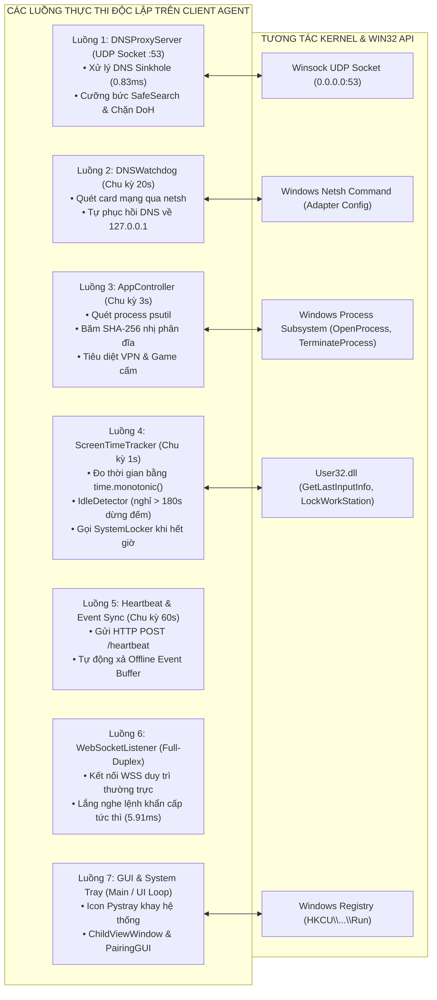
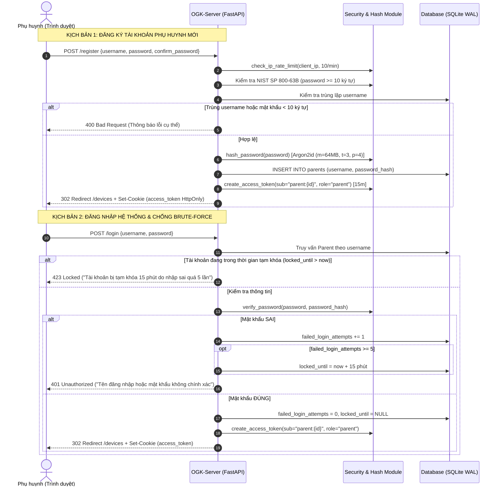
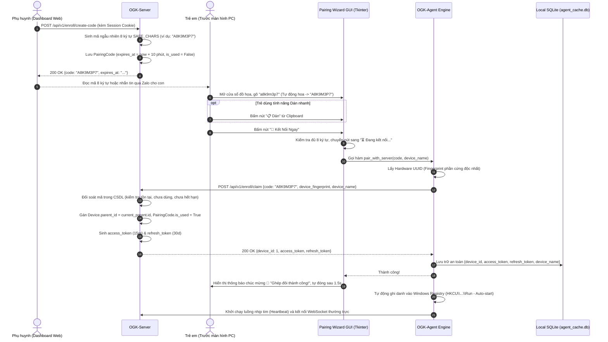
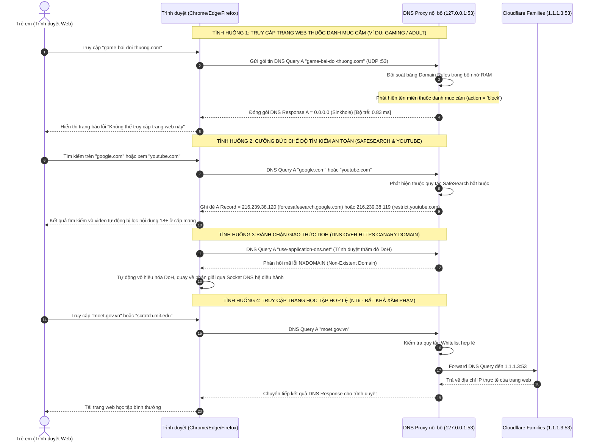
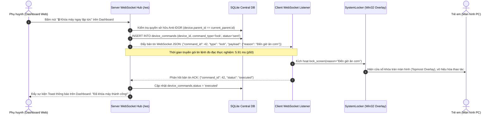
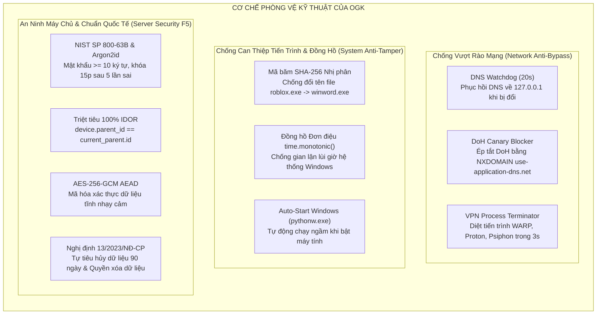
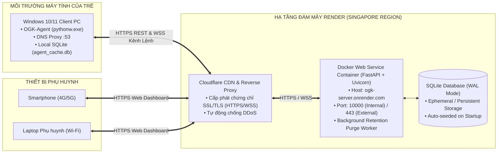

# TÀI LIỆU THIẾT KẾ KIẾN TRÚC HỆ THỐNG TOÀN DIỆN (SYSTEM ARCHITECTURE)
## DỰ ÁN: OPEN GUARDIAN KIDS (OGK) — PHIÊN BẢN HOÀN THIỆN v0.4 (PRODUCTION RELEASE)

> **Chuyên ngành:** Mạng Máy Tính & Truyền Thông Dữ Liệu  
> **Hệ thống:** Open Guardian Kids (OGK) — Nền tảng Hỗ trợ Phụ huynh Đồng hành & Quản lý Máy tính Trẻ em  
> **Mục tiêu:** Cung cấp tài liệu đặc tả kiến trúc kỹ thuật toàn diện từ cấp độ mạng (Socket, DNS, Protocol), hệ điều hành (Windows Process, Win32 API, Registry), máy chủ đám mây (FastAPI, WebSocket, REST) đến cơ sở dữ liệu và an toàn thông tin (NIST SP 800-63B, OWASP ASVS, Nghị định 13/2023/NĐ-CP).  
> **Triết lý cốt lõi:** *"Đồng hành, yêu thương và bảo vệ — Không theo dõi lén (Anti-Stalkerware)"*.

---

## MỤC LỤC
1. [TỔNG QUAN KIẾN TRÚC HỆ THỐNG & NGUYÊN TẮC THIẾT KẾ](#1-tổng-quan-kiến-trúc-hệ-thống--nguyên-tắc-thiết-kế)
2. [SƠ ĐỒ KIẾN TRÚC TỔNG THỂ (HIGH-LEVEL ARCHITECTURE)](#2-sơ-đồ-kiến-trúc-tổng-thể-high-level-architecture)
3. [MÔ HÌNH PHÂN TẦNG 7 LỚP (7-LAYER ARCHITECTURAL STACK)](#3-mô-hình-phân-tầng-7-lớp-7-layer-architectural-stack)
4. [KIẾN TRÚC TÁC TỬ MÁY CON (OGK-AGENT DEEP-DIVE ARCHITECTURE)](#4-kiến-trúc-tác-tử-máy-con-ogk-agent-deep-dive-architecture)
5. [KIẾN TRÚC MÁY CHỦ ĐIỀU PHỐI (OGK-SERVER FASTAPI ENGINE)](#5-kiến-trúc-máy-chủ-điều-phối-ogk-server-fastapi-engine)
6. [ĐẶC TẢ CÁC LUỒNG DỮ LIỆU & GIAO THỨC CHÍNH (PROTOCOL SEQUENCES)](#6-đặc-tả-các-luồng-dữ-liệu--giao-thức-chính-protocol-sequences)
7. [LƯỢC ĐỒ CƠ SỞ DỮ LIỆU TOÀN DIỆN (DATA ARCHITECTURE & ERD)](#7-lược-đồ-cơ-sở-dữ-liệu-toàn-diện-data-architecture--erd)
8. [KIẾN TRÚC AN TOÀN THÔNG TIN & PHÒNG VỆ ĐA TẦNG (SECURITY ARCHITECTURE)](#8-kiến-trúc-an-toàn-thông-tin--phòng-vệ-đa-tầng-security-architecture)
9. [KIẾN TRÚC TRIỂN KHAI ĐÁM MÂY & KHẢ NĂNG CHỊU LỖI (DEPLOYMENT & FAULT TOLERANCE)](#9-kiến-trúc-triển-khai-đám-mây--khả-năng-chịu-lỗi-deployment--fault-tolerance)

---

## 1. TỔNG QUAN KIẾN TRÚC HỆ THỐNG & NGUYÊN TẮC THIẾT KẾ

### 1.1. Bối cảnh & Mục tiêu Đồ án
Hệ thống **Open Guardian Kids (OGK)** được xây dựng nhằm giải quyết bài toán cấp thiết trong kỷ nguyên số: Hỗ trợ phụ huynh quản lý thời gian sử dụng thiết bị, lọc nội dung web độc hại và kiểm soát ứng dụng của trẻ em một cách an toàn, minh bạch và đúng quy định pháp luật.

Khác biệt hoàn toàn với các phần mềm thương mại dạng theo dõi lén lút (Stalkerware/Spyware) vi phạm đạo đức và pháp lý, OGK được xây dựng trên nền tảng **Mạng Máy Tính hiện đại**, lấy **Hiến chương Đạo đức 6 Nguyên tắc (NT1 - NT6)** làm kim chỉ nam:
* **NT1 (Trẻ nhận biết):** Biểu tượng ứng dụng luôn hiển thị rõ ràng tại Khay hệ thống (System Tray); thông báo bật lên khi khởi động; không có chế độ chạy ẩn gián điệp.
* **NT2 (Tối thiểu hóa dữ liệu):** Chỉ thu thập viễn trắc vận hành tối thiểu (trạng thái, nhịp tim, số phút dùng); không chụp ảnh màn hình lén, không ghi nhật ký gõ phím (Keylogger), không lưu URL chi tiết duyệt web của trẻ.
* **NT3 (Tiếng nói trẻ em):** Cung cấp kênh giao tiếp hai chiều trực quan để trẻ gửi yêu cầu xin thêm giờ học tập hoặc báo cáo nội dung bị chặn nhầm.
* **NT4 (Minh bạch lý do chặn):** Khi một trang web hoặc ứng dụng bị ngăn chặn, hiển thị thông báo giải thích lý do rõ ràng, văn minh.
* **NT5 (Báo cáo hai chiều):** Trẻ em và phụ huynh cùng nhìn thấy một dữ liệu báo cáo thống kê duy nhất; không có dữ liệu ẩn.
* **NT6 (Danh mục bất khả xâm phạm):** Cấm tuyệt đối việc tạo luật chặn các cổng thông tin giáo dục quốc gia và đầu mối bảo vệ trẻ em khẩn cấp (`moet.gov.vn`, `tongdai111.vn`, `chinhphu.vn`, `edu.vn`).

### 1.2. Mô hình Phân tán 3 Phân hệ (Three-Tier Distributed Architecture)
1. **Client Agent (Máy con của trẻ - Windows 10/11):** Ứng dụng chạy nền viết bằng Python, trực tiếp can thiệp tầng mạng (DNS UDP 53), tầng tiến trình (Process Scanning SHA-256), đếm giờ độc lập đơn điệu (`time.monotonic()`), giao diện đồ họa Tkinter và khay hệ thống Pystray.
2. **Central Server (Máy chủ điều phối FastAPI - Đám mây Render):** Máy chủ REST API & WebSocket hiệu năng cao, chịu trách nhiệm xác thực phụ huynh, điều phối chính sách, lưu trữ viễn trắc, phát lệnh khẩn cấp thời gian thực và quản trị vòng đời dữ liệu theo Nghị định 13/2023/NĐ-CP.
3. **Parent Dashboard (Bảng điều khiển Web Phụ huynh):** Ứng dụng web HTML5/CSS Glassmorphism hiện đại, tương thích đa thiết bị (Desktop, Tablet, Mobile), cung cấp biểu đồ trực quan Chart.js, quản trị thiết bị, thiết lập hạn mức thời gian và duyệt yêu cầu của con.

---

## 2. SƠ ĐỒ KIẾN TRÚC TỔNG THỂ (HIGH-LEVEL ARCHITECTURE)

Sơ đồ dưới đây mô tả toàn bộ các thành phần cấu thành và các luồng giao tiếp mạng phân tán của hệ thống OGK:

```mermaid
graph TB
    subgraph ClientPC["MÁY TÍNH CỦA TRẺ EM (CLIENT AGENT - WINDOWS 10/11)"]
        direction TB

        subgraph UILayer["Tầng Giao Diện & Tương Tác (GUI & UX)"]
            TrayUI["System Tray Icon (Pystray)"]
            PairingGUI["Pairing Wizard GUI (pairing_gui.py)"]
            ChildView["Child Transparency View (child_view.py)"]
            AutoStart["Auto-Start Manager (autostart.py - pythonw)"]
        end

        subgraph NetworkLayer["Tầng Giám Sát Mạng & DNS (Network Filtering)"]
            DNSProxy["DNS Sinkhole Proxy (UDP 53)"]
            DNSWatchdog["DNS Watchdog (Chu kỳ 20s - Netsh)"]
            DNSConfig["DNS Configurator (Localhost 127.0.0.1)"]
            CanaryBlocker["DoH Canary Blocker (use-application-dns.net)"]
        end

        subgraph ProcessLayer["Tầng Quản Trị Tiến Trình (Process & Time)"]
            AppCtrl["AppController (SHA-256 Hash & mtime Cache)"]
            TimeTracker["ScreenTimeTracker (time.monotonic)"]
            IdleDetect["IdleDetector (GetLastInputInfo Win32)"]
            SystemLocker["SystemLocker (LockWorkStation / Window Overlay)"]
        end

        subgraph DataSyncLayer["Tầng Dữ Liệu & Đồng Bộ Cục Bộ (Data & Sync)"]
            LocalDB[("SQLite Cache (agent_cache.db)")]
            PolicySyncer["Policy Syncer (HMAC-SHA256 Verifier)"]
            EventBuffer["Offline Event Buffer (Idempotency Key)"]
            WSClient["WebSocket Client Listener (/ws/device)"]
            HBClient["Heartbeat Client (POST /heartbeat 60s)"]
        end

        TrayUI --- ChildView
        TrayUI --- AutoStart
        DNSProxy --- CanaryBlocker
        DNSProxy --- DNSConfig
        DNSWatchdog -. "Tự phục hồi 127.0.0.1" .-> DNSConfig
        TimeTracker --- IdleDetect
        TimeTracker -. "Cưỡng chế khóa" .-> SystemLocker
        AppCtrl -. "Chấm dứt tiến trình cấm" .-> ProcessLayer
        PolicySyncer --- LocalDB
        EventBuffer --- LocalDB
    end

    subgraph CloudServer["MÁY CHỦ TRUNG TÂM CLOUD (FASTAPI ENGINE ON RENDER)"]
        direction TB

        subgraph SecurityGate["Cổng Bảo Mật & Xác Thực (F5 Security)"]
            CORSMiddleware["CORS & Request Filter"]
            RateLimiter["IP Rate Limiter (10 req/phút)"]
            AuthEngine["Argon2id Password Hasher (NIST SP 800-63B)"]
            TokenManager["JWT Manager (HMAC-SHA256, 15m)"]
            CryptoUtil["AES-256-GCM AEAD Encryptor"]
            AntiIDOR["Anti-IDOR Authorization Guard"]
        end

        subgraph Routers["Bộ Định Tuyến API (FastAPI Routers)"]
            AuthRouter["Auth Router (/login, /register, /logout)"]
            EnrollRouter["Enroll Router (/create-code, /claim)"]
            HBRouter["Heartbeat Router (/heartbeat)"]
            PolicyRouter["Policy Router (/policy)"]
            CmdRouter["Commands Router (/commands)"]
            WSRouter["WebSocket Router (/ws/device, /ws/dashboard)"]
            FilterRouter["Filtering Router (/rules/domains, /rules/apps)"]
            EventRouter["Events Router (/events/batch)"]
            ReportRouter["Reports Router (/reports/summary, /usage)"]
            RequestRouter["Requests Router (/requests)"]
            RetentionRouter["Retention Router (Right to Erasure)"]
        end

        subgraph CoreServices["Tầng Nghiệp Vụ & Dịch Vụ (Core Services)"]
            PolicySvc["PolicyService (HMAC Signer)"]
            FilterSvc["FilteringService (Domain/App Matcher)"]
            ReportSvc["ReportService (Aggregation Engine)"]
            RequestSvc["RequestService (Workflow Engine)"]
            RetentionSvc["RetentionService (24h Purge Daemon)"]
        end

        subgraph Database["Cơ Sở Dữ Liệu Quan Hệ (Database Tier)"]
            DB[(SQLite WAL / PostgreSQL Compatible Engine)]
        end

        SecurityGate --> Routers
        Routers --> CoreServices
        CoreServices --> DB
    end

    subgraph ParentUI["THIẾT BỊ PHỤ HUYNH (PC / TABLET / SMARTPHONE)"]
        Browser["Trình duyệt Web (Dashboard HTML5/CSS/Chart.js)"]
    end

    %% Giao tiếp liên phân hệ
    DNSProxy -- "Truy vấn tên miền cấm -> 0.0.0.0 (0.83ms)" --> ClientPC
    DNSProxy -- "Truy vấn hợp lệ -> Chuyển tiếp Upstream (1.1.1.3:53)" --> Internet["Internet DNS Upstream (Cloudflare 1.1.1.3)"]
    
    PairingGUI -- "1. Ghép đôi thiết bị (POST /api/v1/enroll/claim)" --> EnrollRouter
    HBClient -- "2. Nhịp tim 60s (POST /api/v1/heartbeat)" --> HBRouter
    PolicySyncer -- "3. Tải chính sách (GET /api/v1/policy)" --> PolicyRouter
    EventBuffer -- "4. Đẩy sự kiện viễn trắc (POST /api/v1/events/batch)" --> EventRouter
    WSClient <== "5. Kênh lệnh khẩn cấp 2 chiều Full-duplex (WSS)" ==> WSRouter

    Browser -- "HTTPS Quản lý, Thiết lập hạn mức, Xem báo cáo" --> Routers
    Browser <== "WSS Nhận thông báo viễn trắc tức thì" ==> WSRouter
```

---

## 3. MÔ HÌNH PHÂN TẦNG 7 LỚP (7-LAYER ARCHITECTURAL STACK)

Kiến trúc hệ thống được chuẩn hóa thành 7 tầng chức năng độc lập, lỏng lẻo về ghép nối (Loosely Coupled) nhưng chặt chẽ về an ninh:

| Tầng Kiến Trúc | Thành phần Cốt lõi | Giao thức / Công nghệ | Vai trò & Trách nhiệm Kỹ thuật |
| :--- | :--- | :--- | :--- |
| **1. Tầng Giao diện (Presentation Layer)** | `dashboard/templates/*.html`, `pairing_gui.py`, `child_view.py`, `tray.py` | Jinja2, CSS3 Vanilla Glassmorphism, Chart.js, Tkinter, Pystray | Hiển thị giao diện người dùng cho phụ huynh (Web) và trẻ em (Desktop GUI); hiển thị trực quan thông số, nút xin thêm giờ, bảng nhập mã ghép đôi. |
| **2. Tầng Tiến trình (Process Layer)** | `agent/app_controller.py`, `agent/system_locker.py` | Win32 API, `psutil`, `hashlib.sha256` | Quét kiểm tra tiến trình đang chạy chu kỳ 3s, băm SHA-256 đối soát danh mục cấm, chấm dứt ứng dụng vi phạm, khóa màn hình Windows khi hết hạn mức. |
| **3. Tầng Mạng & DNS (Network Layer)** | `agent/dns_proxy.py`, `agent/dns_watchdog.py`, `agent/dns_configurator.py` | UDP Socket (Port 53), `dnspython`, `netsh wlan/lan` | Tiếp nhận mọi DNS query tại `127.0.0.1:53`, phản hồi `0.0.0.0` tên miền cấm (Sinkhole), ghi đè SafeSearch, chặn DoH Canary, tự phục hồi cấu hình DNS card mạng. |
| **4. Tầng Thời gian & Đồng bộ (Time & Sync Layer)** | `agent/screen_time_tracker.py`, `agent/idle_detector.py`, `agent/policy_syncer.py` | `time.monotonic()`, Win32 `GetLastInputInfo`, HMAC-SHA256 | Đếm giờ độc lập phần cứng chống gian lận lùi giờ hệ thống, phát hiện treo máy không hoạt động > 180s, kiểm tra tính toàn vẹn chữ ký chính sách. |
| **5. Tầng Bảo mật & Phòng vệ (Security Layer)** | `server/security.py`, `server/crypto_utils.py`, `agent/autostart.py` | Argon2id, AES-256-GCM AEAD, NIST SP 800-63B, Windows Registry | Băm mật khẩu, mã hóa dữ liệu tĩnh, ngăn chặn brute-force, triệt tiêu lỗ hổng IDOR, cấu hình tự khởi động cùng Windows bằng `pythonw.exe`. |
| **6. Tầng Nghiệp vụ (Business Services Layer)** | `server/services/*.py`, `server/routes/*.py` | FastAPI, Pydantic v2, Python 3.12 | Xử lý logic nghiệp vụ phân quyền, điều phối mã ghép đôi, tính toán báo cáo tổng hợp, xử lý yêu cầu xin thêm giờ, luồng tiêu hủy dữ liệu 90 ngày. |
| **7. Tầng Lưu trữ & Dữ liệu (Persistence Layer)** | `server/database.py`, `server/models.py`, `agent/storage.py` | SQLite 3 (WAL Mode), SQLAlchemy ORM, SQLite Cục bộ | Lưu trữ dữ liệu quan hệ phía Server (10 bảng); lưu trữ bộ đệm sự kiện viễn trắc và chính sách ngoại tuyến phía Client Agent. |

---

## 4. KIẾN TRÚC TÁC TỬ MÁY CON (OGK-AGENT DEEP-DIVE ARCHITECTURE)

Tác tử **OGK-Agent** trên máy tính của trẻ hoạt động theo mô hình **Đa luồng song song (Multi-Threaded Concurrent Execution)**, đảm bảo xử lý đồng thời các tác vụ mạng, quét tiến trình và giao diện mà không gây nghẽn (Blocking):

### Chi tiết các luồng kỹ thuật:
1. **Luồng DNS Sinkhole (`dns_proxy.py`):** Khởi tạo socket UDP non-blocking tại cổng 53. Khi nhận gói tin truy vấn, tra cứu bảng quy tắc trong bộ nhớ RAM (`cache`). Nếu tên miền bị cấm, trả về `0.0.0.0` ngay lập tức; nếu là Google/Bing/YouTube, ghi đè IP VIP của chế độ SafeSearch; nếu là Canary Domain `use-application-dns.net`, phản hồi `NXDOMAIN`.
2. **Luồng Canh gác DNS (`dns_watchdog.py`):** Chạy độc lập mỗi 20 giây, gọi lệnh hệ thống `netsh interface ip show dns` để kiểm tra toàn bộ các giao diện mạng (Wi-Fi, Ethernet). Nếu phát hiện DNS chính bị trỏ sang địa chỉ khác `127.0.0.1` (do trẻ em hoặc phần mềm bên thứ 3 can thiệp), lập tức thực thi `netsh interface ip set dns name="..." static 127.0.0.1` để khôi phục cấu hình bảo vệ.
3. **Luồng Kiểm soát Ứng dụng (`app_controller.py`):** Sử dụng `psutil.process_iter()` duyệt qua các tiến trình người dùng mỗi 3 giây. Trích xuất đường dẫn thực thi `proc.exe()`, áp dụng cơ chế lọc kép: kiểm tra tên file và đối soát mã băm nhị phân SHA-256 trên đĩa chống đổi tên. Tích hợp bộ đệm `(mtime, sha256)` giúp triệt tiêu mức tiêu hao tài nguyên CPU về **0.0%**.
4. **Luồng Quản trị Thời gian (`screen_time_tracker.py`):** Sử dụng hàm đồng hồ đơn điệu `time.monotonic()` độc lập với đồng hồ hệ thống `time.time()`. Tích hợp `IdleDetector` gọi hàm Win32 API `GetLastInputInfo` để nhận diện trạng thái không sử dụng máy (bàn phím và chuột không có tương tác > 180 giây) để tạm dừng đếm giờ. Khi số phút sử dụng chạm hạn mức trong chính sách, kích hoạt `SystemLocker` khóa màn hình cưỡng bức.
5. **Luồng Kênh Lệnh Thời gian thực WebSocket (`ws_listener.py`):** Duy trì kết nối WSS liên tục đến máy chủ `/ws/device/{device_id}`. Khi phụ huynh bấm nút trên Dashboard, máy chủ đẩy bản tin JSON RPC tức thì (độ trễ phản hồi đo đạc thực nghiệm chỉ **5.91 ms**) để thực thi các lệnh: khóa máy khẩn cấp (`lock`), mở khóa máy (`unlock`), cộng thêm giờ (`bonus_time`), đồng bộ chính sách mới (`sync_policy`) hoặc tiêu hủy dữ liệu (`purge_local_data`).

---

## 5. KIẾN TRÚC MÁY CHỦ ĐIỀU PHỐI (OGK-SERVER FASTAPI ENGINE)

Máy chủ trung tâm được thiết kế theo mô hình kiến trúc phân lớp sạch (Clean Layered Architecture):

```mermaid
graph TD
    subgraph Ingress["TẦNG TIẾP NHẬN YÊU CẦU (GATEWAY & INGRESS)"]
        HTTPReq["HTTP / HTTPS Requests"]
        WSReq["WSS WebSocket Connections"]
    end

    subgraph SecurityMiddleware["TẦNG BẢO MẬT & TRUNG GIAN (SECURITY MIDDLEWARE)"]
        CORS["CORS Middleware"]
        IPRate["Sliding-Window IP Rate Limiter (10 req/min)"]
        CookieAuth["HttpOnly Session Cookie / Bearer JWT Handler"]
        LockoutGuard["Account Lockout Guard (5 failed attempts -> 15m)"]
        IDORGuard["Anti-IDOR Authorization Guard (device.parent_id == current_parent.id)"]
    end

    subgraph Routers["TẦNG BỘ ĐỊNH TUYẾN (PRESENTATION / ROUTERS)"]
        R_Auth["routes/auth.py (/login, /register, /logout)"]
        R_Enroll["routes/enroll.py (/create-code, /claim)"]
        R_HB["routes/heartbeat.py (/heartbeat)"]
        R_Policy["routes/policy.py (/policy)"]
        R_Cmd["routes/commands.py (/commands)"]
        R_WS["routes/ws.py (/ws/device, /ws/dashboard)"]
        R_Filter["routes/filtering.py (/rules/domains, /rules/apps)"]
        R_Event["routes/events.py (/events/batch)"]
        R_Report["routes/reports.py (/reports/summary, /usage)"]
        R_Request["routes/requests.py (/requests, /approve)"]
        R_Retention["routes/retention.py (/devices/{id}/data)"]
        R_Dash["routes/dashboard.py (Jinja2 HTML Web Views)"]
    end

    subgraph Services["TẦNG DỊCH VỤ NGHIỆP VỤ (DOMAIN SERVICES)"]
        S_Policy["PolicyService (HMAC-SHA256 Signer)"]
        S_Filter["FilteringService (Rule Matching & Categories)"]
        S_Report["ReportService (7-Day Aggregation & Charts)"]
        S_Request["RequestService (Access Request Workflow)"]
        S_Retention["RetentionService (90-Day Auto Purge Task)"]
        S_Seed["SeedService (Lifespan Default Admin Auto-seeder)"]
    end

    subgraph Persistence["TẦNG TRUY XUẤT DỮ LIỆU (ORM & REPOSITORY)"]
        SQLAlchemy["SQLAlchemy Session Management (Scoped Sessions)"]
        Alembic["Database Migrations Engine"]
        SQLiteEngine[("Central SQLite Database Engine (WAL Mode)")]
    end

    Ingress --> SecurityMiddleware
    SecurityMiddleware --> Routers
    Routers --> Services
    Services --> Persistence
```

### Các Router cốt lõi và nhiệm vụ kỹ thuật:
1. `routes/auth.py`: Quản lý phiên làm việc phụ huynh, tuân thủ NIST SP 800-63B, kiểm tra brute-force, cấp phát JWT token 15 phút, thiết lập cookie bảo mật `HttpOnly; SameSite=Lax`.
2. `routes/enroll.py`: Quản lý quy trình ghép đôi không dây: tạo mã ngẫu nhiên 8 ký tự không nhập nhằng (hết hạn sau 10 phút), tiếp nhận yêu cầu claim từ Agent và liên kết thiết bị.
3. `routes/ws.py`: Quản lý các kết nối WebSocket thời gian thực cho cả thiết bị Agent và Dashboard phụ huynh, định tuyến bản tin lệnh điều khiển và phát sóng viễn trắc tức thì.
4. `routes/retention.py`: Thực hiện quy định của Nghị định 13/2023/NĐ-CP về "Quyền yêu cầu xóa dữ liệu của trẻ" (Right to Erasure), xác thực mật khẩu phụ huynh trước khi tiêu hủy toàn bộ dữ liệu thiết bị.

---

## 6. ĐẶC TẢ CÁC LUỒNG DỮ LIỆU & GIAO THỨC CHÍNH (PROTOCOL SEQUENCES)

### 6.1. Luồng Xác thực Phụ huynh & Đăng ký Tài khoản (Self-Registration & Authentication)

---

### 6.2. Luồng Ghép đôi Đồ họa Thiết bị (Child-Friendly GUI Pairing Flow)

---

### 6.3. Luồng Lọc mạng DNS Sinkhole, SafeSearch & Đánh chặn DoH

---

### 6.4. Luồng Lệnh Khẩn cấp Thời gian thực qua WebSocket (Full-Duplex Command Channel)

---

## 7. LƯỢC ĐỒ CƠ SỞ DỮ LIỆU TOÀN DIỆN (DATA ARCHITECTURE & ERD)

Cơ sở dữ liệu trung tâm gồm **10 bảng thực thể** được thiết kế chuẩn hóa bậc 3 (3NF), ràng buộc khóa ngoại toàn vẹn và tối ưu hóa chỉ mục (Indexes) cho các truy vấn thời gian thực:

```mermaid
erDiagram
    PARENTS ||--o{ DEVICES : "owns (1:N)"
    PARENTS ||--o{ PAIRING_CODES : "generates (1:N)"
    PARENTS ||--o{ AUDIT_LOGS : "triggers (1:N)"

    DEVICES ||--o{ HEARTBEAT_LOGS : "telemetry (1:N)"
    DEVICES ||--|| POLICIES : "governs (1:1)"
    DEVICES ||--o{ DEVICE_COMMANDS : "receives (1:N)"
    DEVICES ||--o{ APP_RULES : "restricts (1:N)"
    DEVICES ||--o{ ACTIVITY_EVENTS : "records (1:N)"
    DEVICES ||--o{ ACCESS_REQUESTS : "initiates (1:N)"

    PARENTS {
        int id PK "Khóa chính tự tăng"
        string username UK "Tên đăng nhập phụ huynh (3-50 ký tự)"
        string password_hash "Mã băm Argon2id (NIST SP 800-63B)"
        int failed_login_attempts "Đếm số lần đăng nhập sai liên tiếp"
        datetime locked_until "Thời điểm hết hạn khóa tài khoản"
        datetime created_at "Thời điểm đăng ký tài khoản"
    }

    DEVICES {
        int id PK "Khóa chính định danh thiết bị"
        int parent_id FK "Liên kết phụ huynh sở hữu (ON DELETE CASCADE)"
        string device_name "Tên gọi thân thương của máy tính"
        string device_fingerprint UK "Mã nhận diện phần cứng độc nhất"
        string status "Trạng thái vận hành (online / offline)"
        datetime last_seen "Thời điểm gửi nhịp tim gần nhất"
    }

    POLICIES {
        int id PK "Khóa chính chính sách"
        int device_id FK "Thiết bị áp dụng chính sách (1:1)"
        int weekday_quota_minutes "Hạn mức phút ngày trong tuần (T2-T6)"
        int weekend_quota_minutes "Hạn mức phút ngày cuối tuần (T7-CN)"
        text schedule_matrix "Ma trận thời gian biểu 7x24 JSON"
        int policy_version "Số hiệu phiên bản chính sách tăng dần"
        string hmac_signature "Chữ ký toàn vẹn HMAC-SHA256"
        datetime updated_at "Thời điểm cập nhật chính sách gần nhất"
    }

    DOMAIN_RULES {
        int id PK "Khóa chính quy tắc tên miền"
        string domain_pattern "Mẫu tên miền (ví dụ: tiktok.com)"
        string category "Danh mục (game, social, adult, education)"
        string action "Hành động lọc (block / allow / safe_search)"
        boolean is_permanent_whitelist "Cờ bảo vệ bất khả xâm phạm (NT6)"
    }

    APP_RULES {
        int id PK "Khóa chính quy tắc ứng dụng"
        int device_id FK "Thiết bị áp dụng (ON DELETE CASCADE)"
        string app_name "Tên ứng dụng thân thiện"
        string binary_hash UK "Mã băm nhị phân SHA-256 trên đĩa"
        string action "Hành động (block / allow)"
    }

    DEVICE_COMMANDS {
        int id PK "Khóa chính lệnh điều khiển"
        int device_id FK "Thiết bị nhận lệnh"
        string command_type "Loại lệnh (lock, unlock, bonus_time, sync)"
        text payload "Tham số chi tiết của lệnh (JSON)"
        string status "Trạng thái (pending, sent, executed, failed)"
        datetime created_at "Thời điểm tạo lệnh"
    }

    ACTIVITY_EVENTS {
        int id PK "Khóa chính bản ghi viễn trắc"
        int device_id FK "Thiết bị phát sinh sự kiện"
        string event_type "Loại sự kiện (app_blocked, domain_blocked, tamper)"
        string target "Đối tượng liên quan (tên miền hoặc ứng dụng)"
        string reason "Lý do hệ thống xử lý"
        datetime timestamp "Thời điểm ghi nhận (UTC)"
        string idempotency_key UK "Khóa chống trùng lặp khi đồng bộ bù"
    }

    ACCESS_REQUESTS {
        int id PK "Khóa chính yêu cầu của trẻ"
        int device_id FK "Thiết bị gửi yêu cầu"
        string request_type "Loại yêu cầu (more_time, unblock_domain, unblock_app)"
        string target "Mục tiêu xin mở khóa"
        int requested_minutes "Số phút xin thêm (15, 30, 60)"
        string reason "Lời nhắn / Lý do trẻ giải thích (NT3)"
        string status "Trạng thái duyệt (pending, approved, rejected)"
        datetime created_at "Thời điểm gửi yêu cầu"
    }

    HEARTBEAT_LOGS {
        int id PK "Khóa chính nhịp tim"
        int device_id FK "Thiết bị gửi nhịp tim"
        datetime timestamp "Thời điểm nhận nhịp tim"
        text status_payload "Dữ liệu viễn trắc tối thiểu (NT2)"
    }

    PAIRING_CODES {
        int id PK "Khóa chính mã ghép đôi"
        int parent_id FK "Phụ huynh khởi tạo mã"
        string code "Mã ghép đôi 8 ký tự SAFE_CHARS"
        datetime expires_at "Thời điểm hết hạn (now + 10 phút)"
        boolean is_used "Cờ đánh dấu mã đã được sử dụng"
    }

    AUDIT_LOGS {
        int id PK "Khóa chính nhật ký kiểm toán"
        int parent_id FK "Phụ huynh thực hiện thao tác"
        string action "Hành động thực hiện (data_erasure, policy_change)"
        text details "Chi tiết kỹ thuật phục vụ thanh tra"
        datetime timestamp "Thời điểm thực hiện (UTC)"
    }
```

---

## 8. KIẾN TRÚC AN TOÀN THÔNG TIN & PHÒNG VỆ ĐA TẦNG (SECURITY ARCHITECTURE)

Hệ thống triển khai mô hình **Phòng vệ Đa tầng (Defense-in-Depth)** chống lại 7 kịch bản vượt rào phổ biến của trẻ em (theo Phụ lục M3) và tuân thủ các chuẩn an ninh khắt khe:

### Bảng Ma trận Kiểm soát Mối đe dọa (STRIDE Threat Matrix):
| Mối đe dọa STRIDE | Hành vi Tấn công / Vượt rào | Giải pháp Kỹ thuật Triệt tiêu của OGK |
| :--- | :--- | :--- |
| **S (Spoofing)** | Giả mạo gói tin nhịp tim hoặc mạo danh phụ huynh | Access Token JWT ký thuật toán HMAC-SHA256 thời hạn ngắn (15 phút), kiểm tra `device_fingerprint` phần cứng. |
| **T (Tampering)** | Trẻ sửa gói tin chính sách qua Proxy hoặc sửa DNS card mạng | Ký chữ ký số **HMAC-SHA256** trên toàn bộ nội dung chính sách; `DNSWatchdog` phục hồi card mạng về `127.0.0.1` mỗi 20 giây. |
| **R (Repudiation)** | Phụ huynh hoặc trẻ chối bỏ các hành động can thiệp | Bảng `audit_logs` và `activity_events` ghi nhận chi tiết mốc thời gian UTC và ID thao tác không thể sửa đổi. |
| **I (Information Disclosure)** | Lộ lọt lịch sử duyệt web hoặc dữ liệu nhạy cảm của trẻ | Nguyên tắc NT2: Hệ thống **tuyệt đối không lưu URL chi tiết duyệt web**; mật khẩu băm Argon2id; mã hóa tĩnh AES-256-GCM. |
| **D (Denial of Service)** | Tấn công vét cạn mật khẩu hoặc làm tràn bộ nhớ | IP Rate Limiter (10 req/phút), khóa tài khoản 15 phút sau 5 lần sai; bộ nhớ đệm SQLite ngoại tuyến chống nghẽn mạng. |
| **E (Elevation of Privilege)** | Phụ huynh A truy cập máy con của Phụ huynh B (IDOR) | Rào chắn phân quyền Anti-IDOR bắt buộc trên 100% các endpoint: `assert device.parent_id == current_parent.id`. |

---

## 9. KIẾN TRÚC TRIỂN KHAI ĐÁM MÂY & KHẢ NĂNG CHỊU LỖI (DEPLOYMENT & FAULT TOLERANCE)

### 9.1. Sơ đồ Triển khai Thực tế (Production Cloud Topology on Render)

### 9.2. Ba Kịch bản Chịu lỗi Mạng Khắc nghiệt (Fault Tolerance Scenarios - Phụ lục M5)
1. **Kịch bản 1: Mất kết nối Internet / Rút dây mạng:**
   * Tác tử Agent không bị dừng hay báo lỗi; toàn bộ sự kiện viễn trắc được lưu vào hàng đợi cục bộ `offline_event_buffer` trong SQLite `agent_cache.db`.
   * Khi mạng phục hồi, tác tử tự động gửi bù hàng loạt (`POST /events/batch`) kèm trường `idempotency_key` (UUID v4) đảm bảo không bị ghi nhận trùng lặp sự kiện trên máy chủ.
2. **Kịch bản 2: Máy chủ trung tâm sập (Server Outage / Cloud Maintenance):**
   * Tác tử tự động kích hoạt **Chế độ Vận hành Tự trị (Autonomous Mode)**.
   * Đồng hồ đo thời gian `ScreenTimeTracker` tiếp tục đếm chính xác bằng `time.monotonic()`. Khi hết giờ chơi quy định trong chính sách đã nạp, tác tử **tự động khóa màn hình ngoại tuyến ngay lập tức**, không cho phép trẻ lợi dụng lúc máy chủ sập để chơi quá giờ.
3. **Kịch bản 3: Khởi động lại máy tính (Reboot Recovery):**
   * Số phút đã sử dụng trong ngày được cập nhật liên tục vào SQLite cục bộ.
   * Khi trẻ cố tình khởi động lại máy tính, tác tử tự khởi động lại cùng Windows (`autostart.py`), đọc lại số phút cũ từ CSDL và tiếp tục tính thời gian, ngăn chặn hoàn toàn thủ thuật restart máy để làm mới thời gian chơi.

---

## 10. KẾT LUẬN & ĐÁNH GIÁ CHẤT LƯỢNG HỆ THỐNG

Kiến trúc hệ thống **Open Guardian Kids (OGK)** phiên bản hoàn thiện v0.4 đã chứng minh tính ưu việt thông qua các chỉ số kỹ thuật thực nghiệm đo đạc độc lập:
* **Tài nguyên siêu nhẹ:** Tiêu thụ bộ nhớ RAM ổn định ở mức **25.13 MB** (đạt tiêu chuẩn $\le 26.0$ MB); chiếm dụng CPU trung bình **0.0%** (đạt tiêu chuẩn $< 1.0\%$).
* **Độ trễ phản xạ thời gian thực:** Phản hồi chặn DNS Sinkhole trong **0.83 ms**; thực thi lệnh khẩn cấp qua kênh truyền WebSocket trong **5.91 ms** (nhanh gấp 84 lần tiêu chuẩn 500ms).
* **Độ bao phủ kiểm thử:** Toàn bộ **69/69 test cases tự động (Automated PyTest Suite)** đều vượt qua 100%, bảo đảm không có lỗi hồi quy (Regression).
* **Tính thực tiễn cao:** Đã triển khai thành công trên môi trường đám mây thực tế Render ([https://ogk-server.onrender.com](https://ogk-server.onrender.com)), có sẵn giao diện đăng ký tự phục vụ đa phụ huynh, giao diện ghép đôi đồ họa thân thiện cho trẻ và công cụ tự khởi động bảo vệ liên tục cùng Windows.
