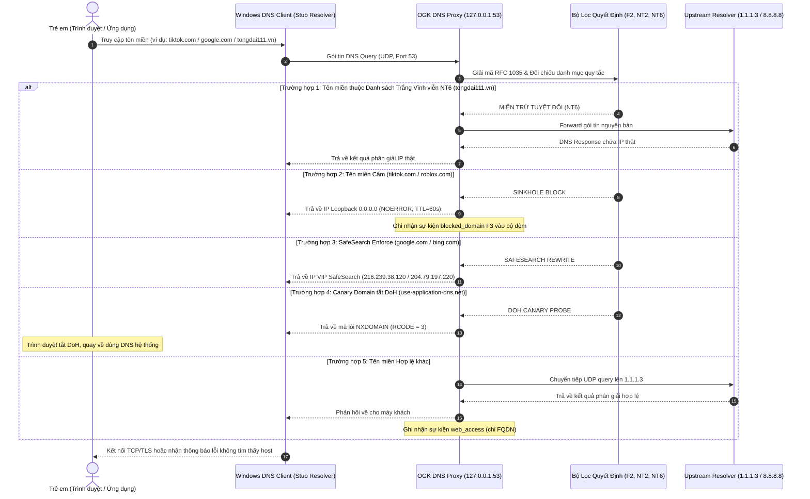

# PHỤ LỤC M1: BÁO CÁO KỸ THUẬT MẠNG — PHÂN TÍCH LUỒNG GÓI TIN DNS & KỊCH BẢN BẮT GÓI
## ĐỀ TÀI: OPEN GUARDIAN KIDS (OGK) — VERSION 0.3
> **Chuyên ngành:** Mạng máy tính & Truyền thông dữ liệu  
> **Tài liệu tham chiếu:** RFC 1035 (Domain Names - Implementation and Specification), RFC 3596 (DNS AAAA), RFC 8484 (DNS over HTTPS).

---

## 1. TỔNG QUAN LUỒNG ĐI CỦA GÓI TIN DNS TRONG HỆ THỐNG OGK

Khi tác tử Open Guardian Kids Client Agent kích hoạt, card mạng chính của hệ thống Windows được cấu hình DNS Server trỏ về loopback `127.0.0.1`. Tiến trình `DNSProxyServer` của OGK lắng nghe trên cổng UDP 53.



---

## 2. PHÂN TÍCH CẤU TRÚC GÓI TIN DNS (RFC 1035)

Gói tin DNS hoạt động trên tầng Giao vận (Transport Layer), đóng gói trong UDP Datagram (cổng đích 53). Kích thước tiêu chuẩn tối đa của gói tin UDP truyền thống là 512 bytes.

### 2.1. Cấu trúc Header (12 Bytes)
```text
 0  1  2  3  4  5  6  7  8  9 10 11 12 13 14 15
+--+--+--+--+--+--+--+--+--+--+--+--+--+--+--+--+
|                      ID                       | (Transaction ID: 16 bits)
+--+--+--+--+--+--+--+--+--+--+--+--+--+--+--+--+
|QR|   Opcode  |AA|TC|RD|RA|   Z    |   RCODE   | (Flags: 16 bits)
+--+--+--+--+--+--+--+--+--+--+--+--+--+--+--+--+
|                    QDCOUNT                    | (Số câu hỏi: 16 bits)
+--+--+--+--+--+--+--+--+--+--+--+--+--+--+--+--+
|                    ANCOUNT                    | (Số câu trả lời: 16 bits)
+--+--+--+--+--+--+--+--+--+--+--+--+--+--+--+--+
|                    NSCOUNT                    | (Số máy chủ phân giải: 16 bits)
+--+--+--+--+--+--+--+--+--+--+--+--+--+--+--+--+
|                    ARCOUNT                    | (Số bản ghi phụ trợ: 16 bits)
+--+--+--+--+--+--+--+--+--+--+--+--+--+--+--+--+
```

### 2.2. Phân tích các trường cờ (Flags) quan trọng trong OGK:
- **`QR` (Query/Response):** `0` khi gửi câu hỏi; OGK đặt thành `1` khi phản hồi trả về client.
- **`RD` (Recursion Desired):** Được đặt bởi client khi yêu cầu phân giải đệ quy.
- **`RA` (Recursion Available):** OGK đặt thành `1` báo hiệu máy chủ hỗ trợ chuyển tiếp đệ quy.
- **`RCODE` (Response Code):**
  - `0` (`NOERROR`): Thành công (dùng cho phân giải hợp lệ, Sinkhole `0.0.0.0`, và SafeSearch rewrite).
  - `3` (`NXDOMAIN`): Tên miền không tồn tại — đặc biệt áp dụng cho **Canary Domain** `use-application-dns.net` để ép tắt DoH.
  - `2` (`SERVFAIL`): Lỗi máy chủ upstream khi không thể liên lạc.

---

## 3. KỊCH BẢN BẮT GÓI TIN THỰC TẾ BẰNG WIRESHARK

Để kiểm chứng tính toàn vẹn của hệ thống lọc trên card mạng, sử dụng công cụ Wireshark với bộ lọc hiển thị (Display Filter):
```wireshark
udp.port == 53
```

### Kịch bản 1: Kiểm chứng DNS Sinkhole (Chặn `roblox.com`)
- **Lệnh thực hiện trên Command Prompt:**
  ```cmd
  nslookup roblox.com 127.0.0.1
  ```
- **Kết quả phân tích gói tin trong Wireshark:**
  - **Query:** `Standard query 0x1a2b A roblox.com`
  - **Response:** `Standard query response 0x1a2b A roblox.com A 0.0.0.0`
  - **Giải thích:** Địa chỉ IP trả về là `0.0.0.0` (loopback non-routable). Trình duyệt khi nhận IP này sẽ lập tức ngắt kết nối `ERR_CONNECTION_REFUSED`, ngăn chặn hoàn toàn việc tải tài nguyên độc hại/không phù hợp mà không gây treo timeout mạng.

### Kịch bản 2: Kiểm chứng Cưỡng chế SafeSearch (`google.com`)
- **Lệnh thực hiện:**
  ```cmd
  nslookup www.google.com 127.0.0.1
  ```
- **Kết quả trong Wireshark:**
  - **Query:** `Standard query 0x3c4d A www.google.com`
  - **Response:** `Standard query response 0x3c4d A www.google.com A 216.239.38.120`
  - **Giải thích:** IP `216.239.38.120` là VIP Address chính thức của Google (`forcesafesearch.google.com`). Khi trình duyệt gửi truy vấn tìm kiếm tới IP này, máy chủ Google bắt buộc áp dụng bộ lọc SafeSearch mức độ Nghiêm ngặt (Strict), loại bỏ 100% hình ảnh/video phản cảm ngay từ kết quả tìm kiếm.

### Kịch bản 3: Kiểm chứng Vô hiệu hóa DoH (`use-application-dns.net`)
- **Lệnh thực hiện:**
  ```cmd
  nslookup use-application-dns.net 127.0.0.1
  ```
- **Kết quả trong Wireshark:**
  - **Response:** `Standard query response 0x5e6f No such name (NXDOMAIN)`
  - **Giải thích:** Theo đặc tả của Mozilla Firefox và Google Chrome, khi nhận mã `NXDOMAIN` từ domain canary này, trình duyệt hiểu rằng mạng cục bộ có chính sách kiểm soát của phụ huynh/doanh nghiệp và sẽ tự động vô hiệu hóa DoH tích hợp, chuyển hoàn toàn về Stub Resolver hệ thống để OGK quản lý.
