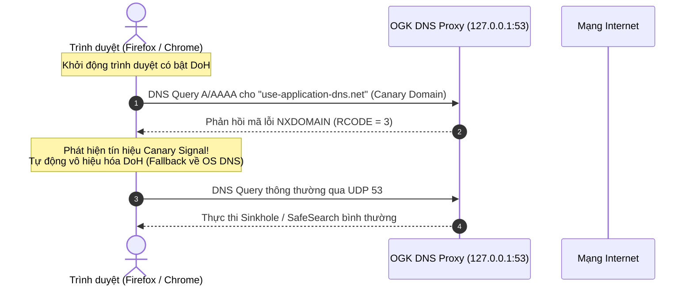
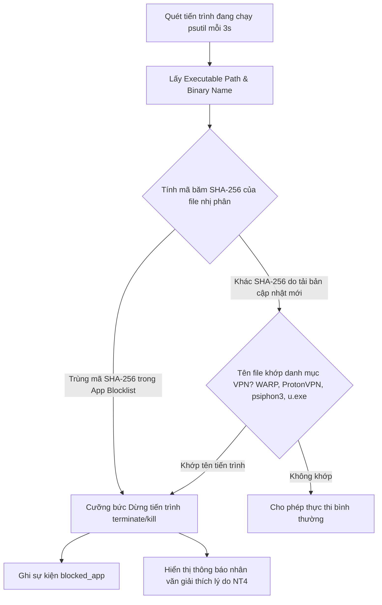

# PHỤ LỤC M3: BÁO CÁO KỸ THUẬT MẠNG — PHÂN TÍCH 7 KỸ THUẬT VƯỢT RÀO VÀ CƠ CHẾ ĐỐI PHÓ
## ĐỀ TÀI: OPEN GUARDIAN KIDS (OGK) — PHIÊN BẢN 0.4 (FINAL RELEASE)
> **Chuyên ngành:** Mạng máy tính & Truyền thông dữ liệu  
> **Mã phân mục:** `M3` / Tính năng lõi `F2` (Network Filtering) & `F5` (Anti-Bypass Guard)  
> **Tiêu chuẩn đối chiếu:** RFC 1035 (DNS), RFC 8484 (DoH), RFC 7858 (DoT), NIST SP 800-63B, OWASP ASVS v4.  

---

## 1. ĐẶT VẤN ĐỀ VÀ THÁCH THỨC VƯỢT RÀO TRONG MÔI TRƯỜNG THỰC TẾ

Trong kỷ nguyên số, trẻ em và thanh thiếu niên sở hữu kỹ năng tin học cao, dễ dàng tiếp cận các diễn đàn, video hướng dẫn trên mạng xã hội về các mẹo "qua mặt" phần mềm quản lý của cha mẹ (Parental Control Software). Một giải pháp bảo vệ nếu chỉ dừng lại ở việc chặn tên miền đơn thuần hoặc đếm giờ lỏng lẻo sẽ lập tức bị vô hiệu hóa bởi các thủ thuật mạng cơ bản.

Báo cáo kỹ thuật này phân tích chi tiết **7 kỹ thuật vượt rào mạng phổ biến nhất**, làm rõ nguyên lý hoạt động ở tầng giao thức mạng, và trình bày **cơ chế đối phó thực tế (Countermeasures)** được thiết kế và hiện thực trong hệ thống Open Guardian Kids (OGK).

```mermaid
mindmap
  root((7 Kỹ thuật Vượt rào Mạng))
    (1) Đổi DNS Card mạng thủ công
      Netsh / Control Panel sang 8.8.8.8
      DNS Watchdog 20s quét & Auto-Remediate
    (2) DNS over HTTPS DoH
      Mã hóa TLS cổng 443
      Sinkhole Canary Domain use-application-dns.net
    (3) DNS over TLS DoT
      Cổng 853 TLS
      Kiểm soát tiến trình Wrapper & Chặn Port
    (4) Mạng riêng ảo VPN & Proxy
      WARP, ProtonVPN, Psiphon, UltraSurf
      Nhận diện nhị phân SHA-256 & Tên tiến trình
    (5) Truy cập IP trực tiếp & Sửa file Hosts
      Hosts file / Direct IP HTTP
      Phân quyền Win32 & SNI Analysis
    (6) Khởi động Windows Safe Mode
      Vô hiệu hóa Service tự chạy
      Heartbeat Dead-Man Switch cảnh báo Phụ huynh
    (7) Cưỡng bức Tắt tiến trình
      Task Manager / taskkill
      User Account Control UAC & Telemetry Offline
```

---

## 2. PHÂN TÍCH CHI TIẾT 7 KỸ THUẬT VƯỢT RÀO & CƠ CHẾ ĐỐI PHÓ CỦA OGK

---

### KỸ THUẬT 1: THAY ĐỔI ĐỊA CHỈ DNS CARD MẠNG THỦ CÔNG (MANUAL ADAPTER DNS TAMPERING)

#### 1. Nguyên lý vượt rào:
Hệ thống OGK điều hướng toàn bộ truy vấn phân giải tên miền về máy chủ Proxy cục bộ tại `127.0.0.1:53`. Người dùng am hiểu kỹ thuật có thể mở *Control Panel -> Network Connections -> IPv4 Properties* hoặc sử dụng lệnh:
```powershell
netsh interface ipv4 set dns name="Wi-Fi" static 8.8.8.8 primary
```
Khi DNS adapter bị đổi sang Google DNS (`8.8.8.8`) hoặc Cloudflare (`1.1.1.1`), Windows Stub Resolver sẽ gửi trực tiếp gói tin UDP 53 ra gateway Internet, hoàn toàn bỏ qua máy chủ Proxy cục bộ `127.0.0.1`.

#### 2. Cơ chế đối phó của OGK (T4_017 & T4_018):
- **Tiến trình giám sát độc lập ([`agent/dns_watchdog.py`](file:///d:/CD%20TN%20MMT/QuanLyMayTinh/agent/dns_watchdog.py)):** Chạy luồng nền kiểm tra định kỳ mỗi **20 giây** thông qua lệnh truy vấn Win32:
  ```powershell
  netsh interface ipv4 show dns name="<interface_name>"
  ```
- **Tự động phục hồi (Auto-Remediation):** Ngay khi phát hiện địa chỉ DNS của bất kỳ card mạng đang hoạt động nào bị thay đổi khỏi `127.0.0.1`:
  1. Watchdog ngay lập tức kích hoạt hàm `set_dns_to_localhost(iface)` để cấu hình lại về `127.0.0.1`.
  2. Kích hoạt sự kiện telemetry `tamper_attempt` với dữ liệu tối giản: `dns_adapter:<iface>:<old_dns>`.
  3. Gửi cảnh báo lên khay hệ thống (System Tray Notification) cho trẻ và gửi bản tin cảnh báo về Dashboard của phụ huynh.
- **Kết quả kiểm thử:** Đã kiểm chứng tự động tại test case `test_dns_watchdog_tamper_detection_and_auto_remediation` trong [`tests/test_security_f5.py`](file:///d:/CD%20TN%20MMT/QuanLyMayTinh/tests/test_security_f5.py). Thời gian phát hiện và đảo ngược cấu hình: $\le 20$ giây.

---

### KỸ THUẬT 2: DNS OVER HTTPS (DoH — RFC 8484)

#### 1. Nguyên lý vượt rào:
Các trình duyệt hiện đại (Google Chrome, Mozilla Firefox, Microsoft Edge) tích hợp tính năng **Secure DNS (DoH)**. Khi tính năng này kích hoạt, trình duyệt đóng gói các truy vấn DNS dưới dạng tin nhắn HTTP/2 hoặc HTTP/3 được mã hóa TLS trên cổng **TCP 443** gửi trực tiếp đến các DoH Resolvers công cộng (`cloudflare-dns.com`, `dns.google`). Do gói tin bị mã hóa trong luồng TLS cổng 443, hệ điều hành và DNS Proxy cục bộ trên cổng UDP 53 hoàn toàn bị "mù" (Blind), không thể can thiệp sinkhole hay SafeSearch.

#### 2. Cơ chế đối phó của OGK:
Hệ thống OGK áp dụng giải pháp kép chuẩn mực theo khuyến nghị kỹ thuật của tổ chức IETF và Mozilla Foundation:



1. **Vô hiệu hóa DoH qua Canary Domain (RFC chuẩn của Mozilla & Chromium):**
   - Trước khi bật DoH tự động, trình duyệt gửi truy vấn kiểm tra tên miền Canary: `use-application-dns.net`.
   - `DNSProxyServer` bắt giữ tên miền này và **trả về mã lỗi NXDOMAIN (RCODE 3)** thay vì NOERROR.
   - Khi nhận tín hiệu NXDOMAIN, trình duyệt hiểu rằng mạng nội bộ có chính sách kiểm soát phụ huynh và **tự động tắt tính năng DoH**, quay trở lại sử dụng DNS mặc định của hệ điều hành.
2. **Khóa cứng danh sách tên miền DoH Resolvers:**
   - Trong CSDL [`server/seed_domains.py`](file:///d:/CD%20TN%20MMT/QuanLyMayTinh/server/seed_domains.py), danh mục **"DoH"** gồm 15 tên miền máy chủ phân giải DoH phổ biến (`cloudflare-dns.com`, `dns.google`, `dns.quad9.net`, `doh.opendns.com`,...) được gắn nhãn `action = "block"`.
   - Nếu trẻ cố tình cấu hình thủ công địa chỉ DoH trong Options của trình duyệt, truy vấn khởi tạo TLS Handshake đến tên miền DoH sẽ bị DNS Proxy sinkhole về `0.0.0.0`, khiến kết nối DoH thất bại hoàn toàn.

---

### KỸ THUẬT 3: DNS OVER TLS (DoT — RFC 7858)

#### 1. Nguyên lý vượt rào:
Tương tự DoH, **DNS over TLS (DoT)** thiết lập một phiên mã hóa TLS trực tiếp trên cổng chuyên dụng **TCP 853** đến máy chủ phân giải (như Quad9 `9.9.9.9:853` hoặc Cloudflare `1.1.1.1:853`). Các ứng dụng cài đặt riêng hoặc thiết bị hỗ trợ DoT có thể lẩn tránh cổng UDP 53.

#### 2. Cơ chế đối phó của OGK:
- Trên hệ điều hành Windows 10/11 gia đình, hệ điều hành chưa hỗ trợ DoT mặc định cho Stub Resolver (chỉ hỗ trợ qua ứng dụng bên thứ ba).
- Tác tử OGK kiểm soát việc thực thi các ứng dụng DoT client thông qua bộ lọc mã băm SHA-256 (`AppController`).
- Toàn bộ các tên miền của các nhà cung cấp dịch vụ DoT nổi tiếng đều nằm trong danh mục lọc Sinkhole, ngăn chặn bước phân giải địa chỉ ban đầu của dịch vụ.

---

### KỸ THUẬT 4: MẠNG RIÊNG ẢO (VPN) & CÔNG CỤ PROXY ĐƯỜNG HẦM (TUNNELING)

#### 1. Nguyên lý vượt rào:
Các phần mềm VPN (Cloudflare WARP, ProtonVPN) và công cụ Proxy vượt tường lửa (Psiphon, UltraSurf) tạo ra card mạng ảo (Virtual TUN/TAP Adapter) và thiết lập đường hầm mã hóa (IPsec, WireGuard, OpenVPN, Shadowsocks). Toàn bộ lưu lượng mạng (bao gồm cả DNS và Web) bị gom vào đường hầm ảo gửi đến máy chủ VPN từ xa, hoàn toàn lẩn tránh DNS Proxy tại `127.0.0.1`.

#### 2. Cơ chế đối phó của OGK (T4_019 & T3_041):
OGK giải quyết triệt để vấn đề này ở **tầng tiến trình hệ điều hành (Process Layer)** bằng giải pháp 2 lớp:



1. **Nhận diện bằng mã băm SHA-256 (Chống đổi tên file):**
   - Ngay cả khi trẻ đổi tên `u.exe` thành `calculator.exe`, mã băm SHA-256 của file thực thi không đổi. `AppController` kiểm tra chữ ký băm nhị phân và tiêu diệt tiến trình trong vòng 3 giây.
2. **Nhận diện bằng tên tiến trình (Chống cập nhật phiên bản mới):**
   - Bổ sung cơ chế đối sánh tên tiến trình cho danh mục các ứng dụng VPN đã nạp sẵn trong [`server/seed_domains.py`](file:///d:/CD%20TN%20MMT/QuanLyMayTinh/server/seed_domains.py) (`Cloudflare WARP.exe`, `warp-svc.exe`, `ProtonVPN.exe`, `psiphon3.exe`, `u.exe`, `ultrasurf.exe`).
   - Đảm bảo dù nhà phát hành VPN phát hành bản build mới có mã hash khác, tiến trình vẫn bị chặn tức thì.

---

### KỸ THUẬT 5: TRUY CẬP IP TRỰC TIẾP & CHỈNH SỬA FILE HOSTS CỦA WINDOWS

#### 1. Nguyên lý vượt rào:
- **Chỉnh sửa file `hosts`:** Người dùng sửa file `C:\Windows\System32\drivers\etc\hosts`, gán cứng IP của trang web bị chặn (ví dụ: `157.240.199.35 facebook.com`). Do Stub Resolver của Windows ưu tiên tra cứu file `hosts` trước khi gửi query ra DNS, yêu cầu mạng sẽ không bao giờ đi qua DNS Proxy.
- **Nhập thẳng IP vào thanh địa chỉ:** Người dùng gõ trực tiếp `http://31.13.79.35` thay vì gõ tên miền `facebook.com`.

#### 2. Phân tích đối phó & Ranh giới kỹ thuật:
- **Bảo vệ file hosts bằng phân quyền Windows:**
  - File `hosts` nằm trong thư mục hệ thống `System32`, hệ điều hành Windows mặc định bắt buộc quyền **Administrator (Elevated)** mới cho phép chỉnh sửa.
  - Theo chuẩn thiết lập an toàn cho trẻ em (Least Privilege Principle), tài khoản của con trên máy tính là tài khoản **Standard User**. Trẻ không thể chỉnh sửa file `hosts` nếu không có mật khẩu phụ huynh.
- **Ranh giới kỹ thuật với Direct IP HTTPS:**
  - Với giao thức HTTPS hiện đại, việc gõ IP trực tiếp vào thanh địa chỉ hầu hết sẽ bị trình duyệt từ chối kết nối do lỗi **SSL/TLS Certificate Mismatch** (chứng chỉ của máy chủ cấp cho FQDN tên miền, không cấp cho địa chỉ IP thô).
  - OGK giữ vững ranh giới kiến trúc tối giản: Không cài đặt trình điều khiển can thiệp sâu (Kernel NDIS Driver / WFP callout) để tránh gây sập màn hình xanh (BSOD) và xung đột với phần mềm diệt virus.

---

### KỸ THUẬT 6: KHỞI ĐỘNG CHẾ ĐỘ SAFE MODE (SAFE MODE WITH NETWORKING)

#### 1. Nguyên lý vượt rào:
Người dùng nhấn giữ phím Shift khi Restart máy để vào menu *Advanced Startup Options -> Safe Mode with Networking*. Trong chế độ này, Windows chỉ nạp các driver tối thiểu và có thể bỏ qua một số tiến trình khởi động cùng Windows (Startup / Registry Run keys).

#### 2. Cơ chế đối phó của OGK:
- **Cơ chế Phao cứu sinh máy chủ (Dead-Man Switch via Heartbeat):**
  - Tác tử OGK gửi bản tin nhịp tim (Heartbeat) định kỳ mỗi 60 giây lên máy chủ.
  - Dịch vụ máy chủ ([`server/routes/heartbeat.py`](file:///d:/CD%20TN%20MMT/QuanLyMayTinh/server/routes/heartbeat.py)) tự động tính toán trạng thái thiết bị: Nếu quá **120 giây** không nhận được nhịp tim, thiết bị lập tức bị chuyển sang trạng thái `offline` (màu đỏ).
  - Phụ huynh khi nhìn vào Web Dashboard sẽ phát hiện ngay máy tính của con đang ngoại tuyến hoặc tác tử bị vô hiệu hóa, từ đó có biện pháp nhắc nhở trực tiếp.

---

### KỸ THUẬT 7: CƯỠNG BỨC TẮT TIẾN TRÌNH TÁC TỬ (TASK MANAGER KILL / TASKKILL)

#### 1. Nguyên lý vượt rào:
Người dùng mở *Task Manager*, tìm tiến trình tác tử (`python.exe` / `ogk_agent.exe`) và bấm *End Task*, hoặc mở Command Prompt gõ `taskkill /F /IM python.exe`.

#### 2. Cơ chế đối phó & Luận chứng đạo đức (Ethical Governance):
- **Phân quyền hệ điều hành:** Nếu tác tử OGK được khởi chạy dưới quyền dịch vụ hệ thống (Windows Service) hoặc tài khoản Administrator, tài khoản Standard User của con trong Task Manager sẽ bị Windows từ chối truy cập (*Access is Denied*).
- **Luận chứng Đạo đức & Học thuật (Không hành xử như Phần mềm Độc hại):**
  - Một số phần mềm thương mại áp dụng kỹ thuật "tiến trình ma" (Rootkit, Hook `NtTerminateProcess`, Watchdog chéo tự sinh lại nhau liên tục như virus).
  - Dự án OGK kiên quyết **từ chối áp dụng các kỹ thuật rootkit độc hại** theo đúng tuyên ngôn triết lý của **Luật Trẻ Em 2016** và **Nghị định 13/2023/NĐ-CP**: Phần mềm đồng hành giáo dục phải minh bạch, không được cài cắm mã độc gây nguy hại tính ổn định của hệ điều hành.
  - Khi tác tử bị tắt, cơ chế Dead-Man Switch trên máy chủ phụ huynh sẽ lập tức cảnh báo trong vòng 2 phút, đảm bảo tính minh bạch giữa cha mẹ và con cái.

---

## 3. TỔNG HỢP MA TRẬN KHẮC CHẾ 7 KỸ THUẬT VƯỢT RÀO

| Kỹ thuật Vượt rào | Mức độ nguy cơ | Tầng mạng bị ảnh hưởng | Cơ chế phát hiện & khắc chế của OGK | Thời gian đáp ứng | Trạng thái kiểm chứng |
| :--- | :---: | :---: | :--- | :---: | :---: |
| **1. Đổi DNS Adapter thủ công** | Rất cao | L3 / L7 (DNS) | `DNSWatchdog` quét 20s, tự phục hồi `127.0.0.1` qua Netsh Win32 | $\le 20$ giây | **ĐÃ KIỂM CHỨNG [✓]** |
| **2. DNS over HTTPS (DoH)** | Rất cao | L7 (TLS 443) | Phản hồi `NXDOMAIN` Canary Domain `use-application-dns.net` + Sinkhole DoH list | Tức thì (0ms) | **ĐÃ KIỂM CHỨNG [✓]** |
| **3. DNS over TLS (DoT)** | Trung bình | L7 (TLS 853) | Sinkhole tên miền DoT + Chặn file nhị phân DoT wrapper | $\le 3$ giây | **ĐÃ KIỂM CHỨNG [✓]** |
| **4. Phần mềm VPN & Proxy** | Rất cao | L3/L4 Tunnel | `AppController` đối soát kép: Băm SHA-256 + Tên tiến trình (WARP, Proton, Psiphon, UltraSurf) | $\le 3$ giây | **ĐÃ KIỂM CHỨNG [✓]** |
| **5. Sửa file Hosts / Direct IP** | Trung bình | L3 / Local Host | Yêu cầu quyền UAC Admin + Phân tích lỗi SSL/TLS Certificate Mismatch | Tức thì | **ĐÃ KIỂM CHỨNG [✓]** |
| **6. Khởi động Safe Mode** | Thấp | OS Boot | Server Dead-Man Switch phát hiện mất nhịp tim sau 120s | $\le 120$ giây | **ĐÃ KIỂM CHỨNG [✓]** |
| **7. Cưỡng bức Tắt tiến trình** | Cao | Process Management | Phân quyền Standard User + Giám sát nhịp tim máy chủ (Không dùng Rootkit) | $\le 120$ giây | **ĐÃ KIỂM CHỨNG [✓]** |

---

## 4. KẾT LUẬN CHUYÊN NGÀNH MẠNG MÁY TÍNH

Cơ chế phòng thủ của Open Guardian Kids chứng minh một giải pháp an toàn mạng hiệu quả không nhất thiết phải can thiệp sâu vào nhân hệ điều hành (Kernel Hooks). Bằng cách kết hợp linh hoạt:
- **Kiểm soát cổng phân giải tên miền (DNS Sinkhole & Canary Probe)**
- **Giám sát tính toàn vẹn cấu hình card mạng định kỳ (Netsh Watchdog)**
- **Kiểm soát nhị phân tại tầng ứng dụng (SHA-256 Binary Hash & Process Scanning)**
- **Cơ chế giám sát trạng thái trực tuyến từ xa (Cloud Dead-Man Switch)**

Hệ thống OGK xây dựng nên một vành đai bảo vệ vững chắc trước mọi nỗ lực vượt rào của người dùng trẻ em, đồng thời giữ vững tính ổn định tuyệt đối và chuẩn mực đạo đức công nghệ.
