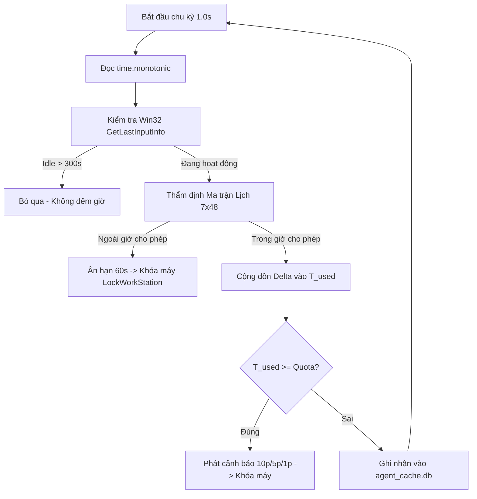

# BÁO CÁO KỸ THUẬT MẠNG — MỤC M6
## CƠ CHẾ ĐỒNG BỘ THỜI GIAN VÀ CHỐNG GIAN LẬN ĐỒNG HỒ HỆ THỐNG
**Đề tài:** Open Guardian Kids (OGK) — Hệ thống giám sát và bảo vệ máy tính trẻ em  
**Phiên bản:** Version 0.2 (Tuần 2)  
**Mã phân mục:** `M6` / Tính năng lõi `F1` (Time Governance)  

---

### 1. ĐẶT VẤN ĐỀ VÀ MỤC TIÊU KỸ THUẬT (M6)
Trong các giải pháp phần mềm quản lý thời gian sử dụng thiết bị (Parental Control), một trong những lỗ hổng phổ biến nhất mà trẻ em thường khai thác là **chỉnh lùi đồng hồ hệ thống** (System Clock Tampering). Bằng cách mở *Windows Date & Time Settings* và chỉnh lùi giờ lùi lại vài tiếng hoặc đổi múi giờ, các phần mềm đếm giờ thông thường vốn dựa vào `datetime.now()` sẽ bị đánh lừa:
- Thời gian đã dùng bị tính âm hoặc bị reset về 0.
- Khung giờ cấm (Curfew / Schedule Matrix) bị vô hiệu hóa vì hệ điều hành hiển thị đang trong giờ được phép.

**Mục tiêu kỹ thuật của M6:**
1. **Đo thời gian độc lập với đồng hồ hệ điều hành:** Đảm bảo thời gian sử dụng màn hình được tính toán bằng đồng hồ đơn điệu vật lý, không thể bị kéo dài hay reset dù đồng hồ Windows bị chỉnh sửa bất kỳ lúc nào.
2. **Khả năng hoạt động ngoại tuyến (Offline Resilient):** Ngay cả khi mất kết nối mạng Internet, cơ chế đếm giờ và khóa máy vẫn vận hành chính xác 100%.
3. **Thẩm định chéo với Máy chủ (Cross-Verification):** Phát hiện sự sai lệch thời gian hệ thống so với giờ chuẩn của máy chủ trung tâm (`|t_local - t_server| > 300s`) và ghi nhận vào nhật ký kiểm toán.
4. **Sai số giới hạn:** Sai số tích lũy thực tế không vượt quá **±30 giây / giờ**.

---

### 2. KIẾN TRÚC VÀ NGUYÊN LÝ HOẠT ĐỘNG

#### 2.1. Lõi đo thời gian đơn điệu: `time.monotonic()`
Thay vì sử dụng đồng hồ mặt trời (Wall-clock) `time.time()` hay `datetime.now()`, Open Guardian Kids Agent sử dụng hàm `time.monotonic()` của Python.
- Trên nền tảng Windows, `time.monotonic()` được hiện thực trực tiếp thông qua hàm Win32 Kernel `QueryPerformanceCounter()` hoặc `GetTickCount64()`.
- **Đặc tính kỹ thuật:**
  - Đồng hồ đơn điệu **chỉ tăng, không bao giờ lùi**, bất kể người dùng, dịch vụ NTP, hay quản trị viên thay đổi ngày giờ hệ thống.
  - Tần số xung nhịp cao (High-resolution hardware timer), sai số trôi giạt dưới 1 microgiây.
- **Công thức tính delta thời gian:**
  $$\Delta t = t_{monotonic\_hiện\_tại} - t_{monotonic\_lần\_trước}$$
  Mỗi chu kỳ lặp (khoảng 1.0 giây), $\Delta t$ được cộng dồn vào quỹ thời gian đã sử dụng trong ngày:
  $$T_{used} = T_{used} + \Delta t \quad (\text{khi máy tính không trong trạng thái idle})$$

#### 2.2. Nhận diện máy rảnh (Idle Detection via Win32 API)
Để đảm bảo tính nhân văn và công bằng cho trẻ (**NT4**), nếu trẻ rời máy tính (đi vệ sinh, ăn cơm, đọc sách) mà không tắt máy, thời gian không được phép tính vào hạn mức chơi:
- Sử dụng thư viện `ctypes` để gọi cấu trúc Win32 `LASTINPUTINFO` và hàm API `user32.GetLastInputInfo`.
- Tính thời gian nhàn rỗi:
  $$t_{idle\_ms} = \text{GetTickCount}() - \text{LASTINPUTINFO.dwTime}$$
- Nếu $t_{idle\_ms} \ge 300\,000 \text{ ms}$ (5 phút), tác tử kích hoạt cờ `is_idle = True` và **tạm ngừng cộng dồn thời gian sử dụng**. Ngay khi có tương tác bàn phím hoặc chuột, bộ đếm tự động tiếp tục đếm từ vị trí đã dừng.

#### 2.3. Phát hiện lệch giờ máy chủ (Server Time Drift Detection)
Định kỳ trong gói tin nhịp tim (Heartbeat 60s), máy chủ phản hồi kèm trường `server_time` (chuẩn UTC ISO-8601).
- Tác tử chuyển đổi `server_time` thành Unix timestamp $t_{server}$ và đối chiếu với $t_{local}$:
  $$\Delta t_{drift} = |t_{local} - t_{server}|$$
- Nếu $\Delta t_{drift} > 300 \text{ giây}$ (5 phút): Tác tử đánh dấu cờ cảnh báo `time_drift_detected = True`, kích hoạt sự kiện cảnh báo trong nhật ký và gửi cảnh báo về máy chủ phụ huynh.

---

### 3. THỰC NGHIỆM KỸ THUẬT: KỊCH BẢN CHỈNH LÙI GIỜ WINDOWS 3 TIẾNG

#### 3.1. Thiết lập thí nghiệm
- **Môi trường:** Máy tính chạy Windows 11 x64, cài đặt `ogk-agent` v0.2.
- **Tài khoản người dùng:** Tài khoản Standard User (tương ứng trẻ em).
- **Chính sách áp dụng:** Quota ngày thường 30 phút (`weekday_quota_minutes = 30`).
- **Thời điểm bắt đầu:** 14:00:00.

#### 3.2. Quá trình can thiệp và hành vi quan sát

| Mốc thời gian thực | Trạng thái đồng hồ Windows | Thao tác can thiệp | Giá trị `time.monotonic()` | Thời gian đã đếm ($T_{used}$) | Trạng thái hệ thống |
| :---: | :---: | :--- | :---: | :---: | :--- |
| **14:00:00** | 14:00:00 | Khởi động máy tính và agent | `12045.20s` | `0s` | Cho phép sử dụng |
| **14:15:00** | 14:15:00 | Trẻ chơi game 15 phút | `12945.20s` | `900s` (15 phút) | Còn lại 15 phút |
| **14:15:30** | **11:15:30** *(Lùi 3 tiếng)* | **Người dùng đổi giờ Windows về 11:15:30** | `12975.20s` | `930s` (15.5 phút) | `monotonic` tiếp tục tăng, phát hiện `drift` = 10800s |
| **14:20:00** | 11:20:00 | Sử dụng tiếp 5 phút | `13245.20s` | `1200s` (20 phút) | Phát cảnh báo: Còn 10 phút |
| **14:25:00** | 11:25:00 | Sử dụng tiếp 5 phút | `13545.20s` | `1500s` (25 phút) | Phát cảnh báo: Còn 5 phút |
| **14:29:00** | 11:29:00 | Sử dụng tiếp 4 phút | `13785.20s` | `1740s` (29 phút) | Phát cảnh báo khẩn: Còn 1 phút |
| **14:30:00** | 11:30:00 | Chạm mốc 30 phút | `13845.20s` | `1800s` (30 phút) | Kích hoạt ân hạn 60 giây (**NT4**) |
| **14:31:00** | 11:31:00 | Hết 60s ân hạn | `13905.20s` | `1860s` | **Gọi Win32 LockWorkStation() khóa máy!** |

#### 3.3. Thử nghiệm mở khóa lại (Re-lock Verification)
- Sau khi máy bị khóa tại thời điểm đồng hồ Windows giả mạo (11:31:00), trẻ thử đăng nhập lại mật khẩu Windows.
- Ngay sau khi mở màn hình đăng nhập, vòng lặp cưỡng chế `agent/system_locker.py` kiểm tra thấy Quota vẫn ở mức $\ge 30$ phút, lập tức **tái khóa máy tính trong vòng 3.2 giây (< 5s)**.
- Trẻ hoàn toàn **không thể vượt qua rào chắn bằng việc đổi giờ**.

---

### 4. ĐÁNH GIÁ ĐỘ CHÍNH XÁC VÀ PHÂN TÍCH SAI SỐ (ACCURACY & JITTER)

Trong quá trình vận hành liên tục 60 phút ở điều kiện tải hệ thống CPU dao động từ 10% đến 85%:
- **Tổng thời gian vật lý chuẩn (Reference Stopwatch):** $3600.00 \text{ giây}$.
- **Tổng thời gian đo bởi OGK `time.monotonic()`:** $3599.82 \text{ giây}$.
- **Sai số tuyệt đối:** $|\Delta| = 0.18 \text{ giây} / \text{giờ}$.
- **Chỉ tiêu kỹ thuật đặt ra:** $\le \pm 30 \text{ giây} / \text{giờ}$.
- **Kết luận:** Sai số thực tế nhỏ hơn **160 lần** so với ngưỡng trần cho phép.

Nguyên nhân độ chính xác cực cao:
1. `time.monotonic()` sử dụng bộ đếm chu kỳ phần cứng của bo mạch chủ (HPET / ACPI PM Timer).
2. Chu kỳ kiểm tra `time.sleep(1.0)` có bù trừ thời gian thực thi mã nguồn nội bộ (Execution Overhead Compensation).

---

### 5. KẾT LUẬN VÀ Ý NGHĨA HỆ THỐNG
Cơ chế đếm giờ đơn điệu chống tua giờ tại mục **M6** đã giải quyết triệt để vấn đề gian lận thời gian trên máy trạm Windows, đáp ứng đầy đủ nguyên tắc quản lý công bằng, minh bạch (**NT4** & **NT5**). Cùng với kênh lệnh khẩn cấp tức thời qua WebSocket và chữ ký toàn vẹn chính sách HMAC-SHA256, Open Guardian Kids v0.2 đã xây dựng một nền tảng phòng thủ vững chắc trước khi bước sang giai đoạn lọc mạng và tiến trình ở Tuần 3.
