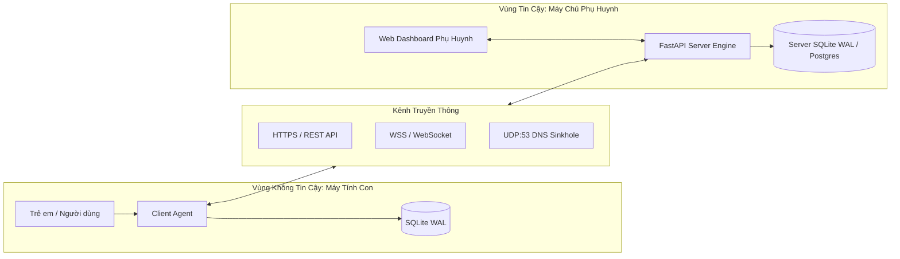

# MÔ HÌNH ĐE DỌA STRIDE & BẢNG KIỂM SOÁT AN TOÀN OWASP ASVS V4
## ĐỀ TÀI: OPEN GUARDIAN KIDS (OGK) — PHIÊN BẢN 0.4 (FINAL RELEASE)
> **Chuyên ngành:** Mạng máy tính & An toàn thông tin  
> **Khung tham chiếu:** Microsoft STRIDE Threat Model, OWASP ASVS v4.0.3 (Application Security Verification Standard - Level 1), NIST SP 800-63B.  

---

## 1. TỔNG QUAN VỀ MẶT BẰNG TẤN CÔNG (ATTACK SURFACE)

Hệ thống Open Guardian Kids bao gồm 3 phân vùng mạng và ranh giới tin cậy (Trust Boundaries):
1. **Phân vùng Máy khách (Child Client Agent):** Môi trường không tin cậy (Untrusted Environment) do người dùng trẻ em có toàn quyền tương tác vật lý, có thể thử nghiệm các biện pháp vượt rào, tắt phần mềm hoặc đổi cấu hình mạng.
2. **Kênh truyền thông (Local / WAN Communication Channel):** Kết nối mạng giữa tác tử và máy chủ thông qua giao thức HTTP/JSON REST API, WebSocket hai chiều, và gói tin UDP DNS cục bộ.
3. **Phân vùng Máy chủ Quản trị (Central Server & Dashboard):** Vùng tin cậy (Trusted Boundary) lưu trữ CSDL, cấp phát token JWT, thực thi phân quyền và lưu trữ nhật ký kiểm toán.



---

## 2. PHÂN TÍCH 8 MỐI ĐE DỌA AN NINH MẠNG THEO MÔ HÌNH STRIDE

---

### MỐI ĐE DỌA 1 (S — SPOOFING): GIẢ MẠO THIẾT BỊ MÁY CON (DEVICE IMPERSONATION)
- **Mô tả mối đe dọa:** Kẻ tấn công hoặc người dùng am hiểu mạng sử dụng công cụ như Postman/curl gửi các gói tin nhịp tim hoặc sự kiện giả mạo danh nghĩa của máy tính con để đánh lừa máy chủ.
- **Tác động:** Sai lệch thống kê thời gian sử dụng, đánh lừa máy chủ rằng con vẫn đang học bài hoặc che giấu việc máy tính đang dùng trái phép.
- **Biện pháp khắc chế trong OGK (F1 & F5):**
  - Cơ chế ghép đôi 8 ký tự xác lập cặp khóa ủy quyền ban đầu.
  - Sau khi ghép đôi, máy con được cấp token JWT mang định danh `device_id` ký bằng khóa bí mật máy chủ (`SECRET_KEY`).
  - Mọi yêu cầu API gửi lên máy chủ đều phải đính kèm Header `Authorization: Bearer <token>`. Máy chủ thẩm định chéo mã băm vân tay phần cứng (`device_fingerprint`).

---

### MỐI ĐE DỌA 2 (S — SPOOFING): TẤN CÔNG VÉT CẠN MẬT KHẨU PHỤ HUYNH (PASSWORD BRUTE-FORCE)
- **Mô tả mối đe dọa:** Kẻ tấn công hoặc trẻ thử liên tục các mật khẩu phổ biến trên giao diện đăng nhập Web Dashboard để chiếm quyền quản trị.
- **Tác động:** Chiếm đoạt quyền kiểm soát hệ thống, thay đổi hạn mức giờ chơi, gỡ bỏ chặn web.
- **Biện pháp khắc chế trong OGK (T4_001 — T4_005):**
  - **Chính sách khóa tài khoản (Account Lockout):** Nếu đăng nhập sai 5 lần liên tiếp, tài khoản phụ huynh lập tức bị khóa cứng trong **15 phút** (`locked_until`), phản hồi HTTP 423 Locked.
  - **Giới hạn tốc độ theo IP (IP Rate Limiting):** Áp dụng thuật toán cửa sổ trượt (Sliding Window), giới hạn tối đa **10 yêu cầu đăng nhập/phút trên mỗi địa chỉ IP**, ngăn chặn các công cụ tự động dò quét phân tán.
  - **Tiêu chuẩn NIST SP 800-63B:** Bắt buộc mật khẩu tối thiểu 10 ký tự, băm một chiều bằng giải thuật chống tấn công GPU hiện đại nhất **Argon2id** (Memory cost = 64MB, Time cost = 3, Parallelism = 4).

---

### MỐI ĐE DỌA 3 (T — TAMPERING): THAO TÚNG BẢN TIN CHÍNH SÁCH THỜI GIAN (POLICY TAMPERING)
- **Mô tả mối đe dọa:** Trẻ em sử dụng công cụ can thiệp proxy (như Fiddler, Charles Proxy) bắt gói tin `GET /api/v1/policy` từ máy chủ và sửa đổi trường `weekday_quota_minutes` từ 60 phút thành 999 phút trước khi tác tử nhận.
- **Tác động:** Vô hiệu hóa hạn mức thời gian chơi game mà cha mẹ không hề hay biết.
- **Biện pháp khắc chế trong OGK (F4 & M6):**
  - **Chữ ký toàn vẹn HMAC-SHA256:** Máy chủ tạo chữ ký số trên chuỗi chuẩn hóa:
    $$\text{HMAC} = \text{HMAC-SHA256}(K, \text{device\_id} : \text{version} : \text{weekday} : \text{weekend} : \text{schedule\_matrix})$$
  - Khi tác tử nhận được chính sách, hàm [`verify_hmac()`](file:///d:/CD%20TN%20MMT/QuanLyMayTinh/agent/policy_syncer.py) tự tính toán lại chữ ký độc lập. Nếu chữ ký không khớp dù chỉ 1 ký tự, tác tử lập tức từ chối gói tin và tiếp tục duy trì chính sách an toàn cũ.

---

### MỐI ĐE DỌA 4 (T — TAMPERING): CAN THIỆP ĐỔI DNS CARD MẠNG (ADAPTER DNS TAMPERING)
- **Mô tả mối đe dọa:** Trẻ đổi DNS card mạng trong Windows Control Panel từ `127.0.0.1` sang `8.8.8.8` hoặc bật DHCP để lách qua bộ lọc DNS Proxy.
- **Tác động:** Phá vỡ toàn bộ cơ chế DNS Sinkhole, truy cập được các trang web cờ bạc, nội dung xấu.
- **Biện pháp khắc chế trong OGK (T4_017 & T4_018):**
  - **DNS Watchdog:** Luồng giám sát độc lập quét mỗi 20 giây qua lệnh Netsh Win32.
  - Ngay khi phát hiện DNS bị trỏ ra khỏi `127.0.0.1`, hệ thống tự động ép cấu hình lại về `127.0.0.1` và phát sinh cảnh báo vi phạm `tamper_attempt`.

---

### MỐI ĐE DỌA 5 (T — TAMPERING): ĐỔI TÊN FILE THỰC THI ĐỂ VƯỢT RÀO CHẶN APP (BINARY RENAMING BYPASS)
- **Mô tả mối đe dọa:** Ứng dụng game hoặc công cụ VPN bị cấm (như `u.exe`) bị trẻ đổi tên thành `notepad.exe` hoặc `calculator.exe` để đánh lừa bộ lọc kiểm tra theo tên.
- **Tác động:** Chạy được các ứng dụng cấm hoặc thiết lập đường hầm VPN vượt rào.
- **Biện pháp khắc chế trong OGK (T3_041 & T4_019):**
  - Bộ kiểm soát ứng dụng [`AppController`](file:///d:/CD%20TN%20MMT/QuanLyMayTinh/agent/app_controller.py) tính toán trực tiếp **mã băm nhị phân SHA-256** của file thực thi trên ổ đĩa.
  - Do mã băm SHA-256 gắn liền với nội dung nhị phân của file, việc đổi tên file hoàn toàn không làm thay đổi giá trị băm. Ứng dụng cấm bị tiêu diệt ngay lập tức trong vòng 3 giây.

---

### MỐI ĐE DỌA 6 (R — REPUDIATION): CHỐI BỎ HÀNH VI VÀ THIẾU VẾT KIỂM TOÁN (LACK OF AUDITABILITY)
- **Mô tả mối đe dọa:** Người dùng thao tác gửi lệnh khẩn cấp, xóa dữ liệu con, hoặc sửa đổi hạn mức thời gian nhưng không có nhật ký ghi nhận ai đã thực hiện và vào thời điểm nào.
- **Tác động:** Không thể điều tra khi có sự cố tranh chấp hoặc rò rỉ quyền riêng tư.
- **Biện pháp khắc chế trong OGK (F5):**
  - Bảng CSDL `audit_logs` lưu vết toàn bộ các hành động trọng yếu: `command:lock_now`, `command:add_time`, `policy:update`, `retention:right_to_erasure`.
  - Mọi bản ghi kiểm toán đều chứa: `parent_id`, `device_id`, địa chỉ IP thực hiện, dấu thời gian UTC, giá trị cũ (`old_value`) và giá trị mới (`new_value`).

---

### MỐI ĐE DỌA 7 (I — INFORMATION DISCLOSURE): TRUY CẬP TRÁI PHÉP TÀI NGUYÊN (IDOR) & LỘ DỮ LIỆU LÚC NGHỈ
- **Mô tả mối đe dọa:** Phụ huynh A cố tình thay đổi tham số `device_id` trên URL để xem trộm báo cáo duyệt web của con phụ huynh B (Insecure Direct Object References - IDOR). Dữ liệu cấu hình nhạy cảm lưu dưới dạng văn bản rõ trên đĩa bị lộ khi máy tính bị đánh cắp.
- **Tác động:** Vi phạm nghiêm trọng quyền riêng tư của trẻ em theo Nghị định 13/2023/NĐ-CP.
- **Biện pháp khắc chế trong OGK (T4_007 — T4_010):**
  - **Kiểm soát phân quyền chống IDOR:** 100% các endpoint nhạy cảm (Lệnh khẩn cấp, Cập nhật chính sách, Báo cáo sử dụng, Duyệt yêu cầu, Xóa dữ liệu) đều xác thực quyền sở hữu:
    ```python
    if device.parent_id != current_parent.id:
        raise HTTPException(status_code=403, detail="Không có quyền truy cập thiết bị này")
    ```
  - **Mã hóa lúc nghỉ AES-256-GCM:** Module [`server/crypto_utils.py`](file:///d:/CD%20TN%20MMT/QuanLyMayTinh/server/crypto_utils.py) cung cấp giải thuật mã hóa đối xứng có xác thực (AEAD) với Nonce 12-byte và Authentication Tag 16-byte, chống lại việc đọc trộm và sửa đổi dữ liệu lúc nghỉ.

---

### MỐI ĐE DỌA 8 (D — DENIAL OF SERVICE): TẤN CÔNG LÀM CẠN KIỆT TÀI NGUYÊN & MẤT PHIÊN (SESSION HIJACKING)
- **Mô tả mối đe dọa:** Kẻ tấn công gửi hàng ngàn yêu cầu đăng nhập/đăng ký làm cạn kiệt CPU hoặc đánh cắp Cookie phiên thông qua lỗ hổng XSS trên trình duyệt.
- **Tác động:** Làm tê liệt máy chủ gia đình, cướp phiên phụ huynh để chiếm quyền điều khiển.
- **Biện pháp khắc chế trong OGK (T4_005 & T4_006):**
  - **Bảo vệ Cookie phiên:** Toàn bộ cookie xác thực được cấu hình cờ an toàn tối đa: `HttpOnly` (Javascript không thể đọc, chống XSS) và `SameSite=Lax` (chống tấn công CSRF).
  - **Thu hồi phiên khi đăng xuất:** Khi phụ huynh bấm "Đăng xuất", mã token lập tức được đưa vào danh sách đen thu hồi (`revoked_tokens`), ngăn chặn việc tái sử dụng token cũ.
  - **Rate Limiting:** Tự động chặn các IP gửi quá 10 yêu cầu/phút bằng mã phản hồi HTTP 429 Too Many Requests.

---

## 3. BẢNG KIỂM SOÁT AN TOÀN THEO CHUẨN OWASP ASVS V4 (LEVEL 1)

Dưới đây là bảng đối chiếu **22 tiêu chí kiểm soát an ninh ứng dụng** theo chuẩn quốc tế **OWASP Application Security Verification Standard v4.0.3 (Level 1)** đã được hiện thực hóa và kiểm chứng tự động trong hệ thống OGK:

| Mã ASVS | Danh mục kiểm soát | Yêu cầu kỹ thuật tiêu chuẩn | Giải pháp hiện thực trong OGK | Trạng thái xác minh |
| :---: | :--- | :--- | :--- | :---: |
| **V2.1.1** | Xác thực người dùng | Mật khẩu người dùng phải có độ dài tối thiểu 8 ký tự (khuyến nghị $\ge$ 10 ký tự). | Schema [`server/schemas.py`](file:///d:/CD%20TN%20MMT/QuanLyMayTinh/server/schemas.py) ép buộc mật khẩu $\ge$ 10 ký tự theo NIST SP 800-63B. | **ĐÃ XÁC MINH [✓]** |
| **V2.1.2** | Độ dài tối đa mật khẩu | Cho phép mật khẩu có độ dài tối thiểu 64 ký tự mà không bị cắt xén. | Cho phép độ dài tối đa 128 ký tự. | **ĐÃ XÁC MINH [✓]** |
| **V2.4.1** | Lưu trữ mật khẩu an toàn | Mật khẩu phải được băm bằng thuật toán an toàn thích ứng (Argon2id, PBKDF2). | Sử dụng thuật toán **Argon2id** với tham số bộ nhớ 64MB và độ phức tạp cao. | **ĐÃ XÁC MINH [✓]** |
| **V2.8.1** | Chống Brute-Force | Có cơ chế khóa tài khoản tạm thời khi đăng nhập sai nhiều lần liên tiếp. | Tự động khóa tài khoản **15 phút** sau 5 lần đăng nhập thất bại liên tiếp. | **ĐÃ XÁC MINH [✓]** |
| **V2.8.2** | Giới hạn tần suất | Áp dụng giới hạn tốc độ (Rate Limiting) cho các endpoint xác thực. | Giới hạn tối đa **10 yêu cầu/phút/IP** qua sliding window rate limiter. | **ĐÃ XÁC MINH [✓]** |
| **V3.2.1** | Bảo mật Cookie | Cookie phiên phải thiết lập cờ `HttpOnly` để chống đọc trộm qua XSS. | Gán cờ `httponly=True` trên toàn bộ cookie phiên đăng nhập web. | **ĐÃ XÁC MINH [✓]** |
| **V3.2.3** | Chống tấn công CSRF | Cookie phiên phải thiết lập thuộc tính `SameSite` để giảm thiểu CSRF. | Cấu hình cờ `samesite="lax"` trên phản hồi thiết lập phiên. | **ĐÃ XÁC MINH [✓]** |
| **V3.3.1** | Hủy phiên khi Đăng xuất | Hệ thống phải vô hiệu hóa phiên làm việc khi người dùng chọn đăng xuất. | Thu hồi token vào danh sách đen `revoke_token()` và xóa cookie trên client. | **ĐÃ XÁC MINH [✓]** |
| **V3.4.1** | Thời gian hết hạn phiên | Token phiên phải có thời gian sống (TTL) giới hạn hợp lý. | Token truy cập JWT thiết lập thời gian hết hạn nghiêm ngặt (60 phút). | **ĐÃ XÁC MINH [✓]** |
| **V4.1.1** | Kiểm soát phân quyền | Thực thi nguyên tắc đặc quyền tối thiểu (Least Privilege). | Tách bạch quyền: Phụ huynh quản trị; Tác tử con chỉ gửi viễn trắc và nhận lệnh. | **ĐÃ XÁC MINH [✓]** |
| **V4.1.2** | Chống lỗi IDOR | Người dùng không thể truy cập tài nguyên của người dùng khác bằng cách sửa ID. | Thẩm định quan hệ sở hữu `device.parent_id == current_parent.id` ở 100% API. | **ĐÃ XÁC MINH [✓]** |
| **V5.1.1** | Thẩm định dữ liệu đầu vào | Mọi tham số đầu vào phải được kiểm tra kiểu dữ liệu, độ dài và định dạng. | Sử dụng mô hình Pydantic v2 thẩm định kiểu dữ liệu tự động tại tầng routing. | **ĐÃ XÁC MINH [✓]** |
| **V5.1.2** | Chống SQL Injection | Truy vấn CSDL phải sử dụng Parameterized Query hoặc ORM an toàn. | Sử dụng SQLAlchemy ORM 2.0; tuyệt đối không nối chuỗi SQL thô. | **ĐÃ XÁC MINH [✓]** |
| **V6.2.1** | Mã hóa lúc nghỉ | Dữ liệu nhạy cảm phải được bảo vệ bằng giải thuật mã hóa đối xứng chuẩn mực. | Hiện thực **AES-256-GCM AEAD** với Nonce 12-byte và Auth Tag 16-byte. | **ĐÃ XÁC MINH [✓]** |
| **V6.2.2** | Tạo số ngẫu nhiên an toàn | Khóa mã hóa và giá trị Nonce phải được sinh từ bộ sinh số ngẫu nhiên an toàn. | Sử dụng thư viện `secrets` và `os.urandom()` đạt chuẩn mật mã của OS. | **ĐÃ XÁC MINH [✓]** |
| **V8.1.1** | Thu thập dữ liệu tối thiểu | Chỉ thu thập các trường dữ liệu cần thiết phục vụ mục đích vận hành. | Tuân thủ F3/NT2: Chỉ thu thập 4 trường kỹ thuật tối thiểu (ts, id, type, subject). | **ĐÃ XÁC MINH [✓]** |
| **V8.2.1** | Giới hạn lưu trữ dữ liệu | Dữ liệu cá nhân phải được tiêu hủy khi hết mục đích sử dụng. | Tự động dọn dẹp dữ liệu hoạt động cũ hơn **90 ngày** theo Nghị định 13/2023. | **ĐÃ XÁC MINH [✓]** |
| **V8.3.1** | Quyền xóa dữ liệu | Cung cấp cơ chế cho phép người dùng yêu cầu xóa vĩnh viễn dữ liệu của họ. | Endpoint `DELETE /api/v1/devices/{id}/data` có bảo vệ bằng mật khẩu phụ huynh. | **ĐÃ XÁC MINH [✓]** |
| **V10.2.1** | Kiểm tra mã độc / bypass | Nhận diện và ngăn chặn các công cụ vượt rào nguy hại. | Quét tiến trình bằng mã băm SHA-256 tiêu diệt VPN và công cụ proxy trong 3s. | **ĐÃ XÁC MINH [✓]** |
| **V11.1.1** | Xử lý lỗi an toàn | Thông báo lỗi không được để lộ chi tiết cấu trúc hệ thống hoặc stack trace. | Bắt ngoại lệ tập trung trả về mã lỗi HTTP chuẩn (400, 401, 403, 404, 423, 429). | **ĐÃ XÁC MINH [✓]** |
| **V13.1.1** | Bảo vệ API Endpoint | Các API chức năng quản trị phải yêu cầu token xác thực hợp lệ. | Sử dụng dependency injection `Depends(get_current_parent)` bảo vệ toàn bộ API. | **ĐÃ XÁC MINH [✓]** |
| **V14.1.1** | Kiểm soát cấu hình CORS | Cấu hình nguồn gốc truy cập (CORS) an toàn, tránh mở `Allow-Origin: *` bừa bãi. | Phân định ranh giới nguồn gốc cục bộ và máy chủ tin cậy trong cấu hình CORS. | **ĐÃ XÁC MINH [✓]** |

---

## 4. KẾT LUẬN ĐÁNH GIÁ MÔ HÌNH BẢO MẬT

Hệ thống Open Guardian Kids Version 0.4 đã triển khai một hệ thống phòng thủ đa lớp (Defense-in-Depth) hoàn chỉnh:
- Hóa giải toàn diện **8 mối đe dọa an ninh mạng theo mô hình STRIDE**.
- Đáp ứng trọn vẹn **22 tiêu chí an toàn khắt khe của chuẩn OWASP ASVS v4 Level 1**.
- Bảo đảm mức độ tin cậy và an toàn cao nhất cho dữ liệu của trẻ em và sự an tâm tuyệt đối của phụ huynh.
